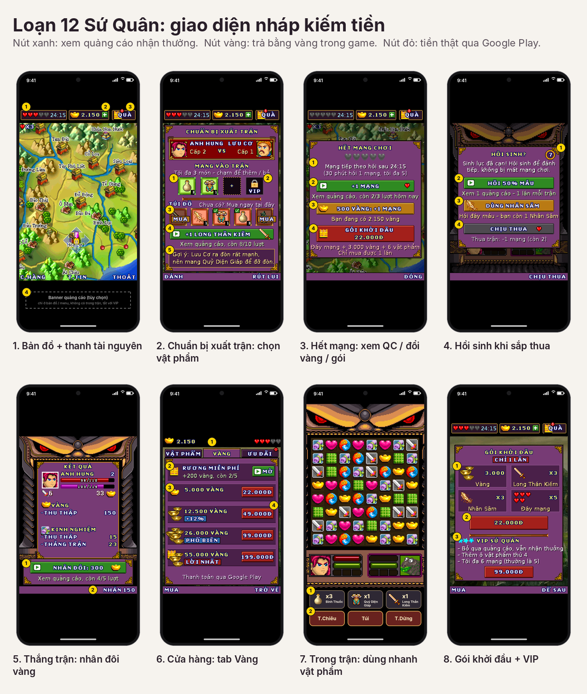
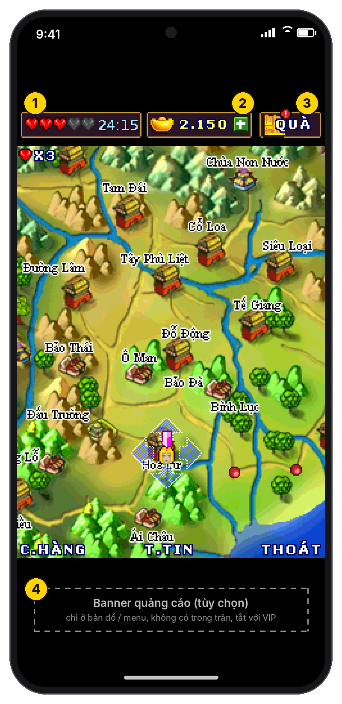
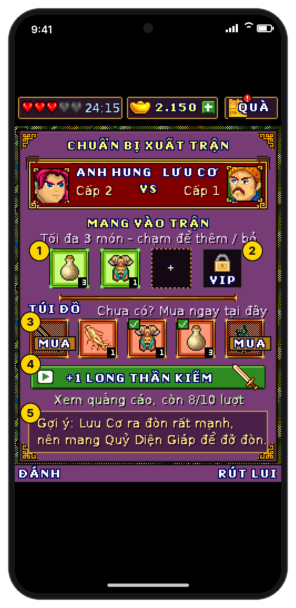
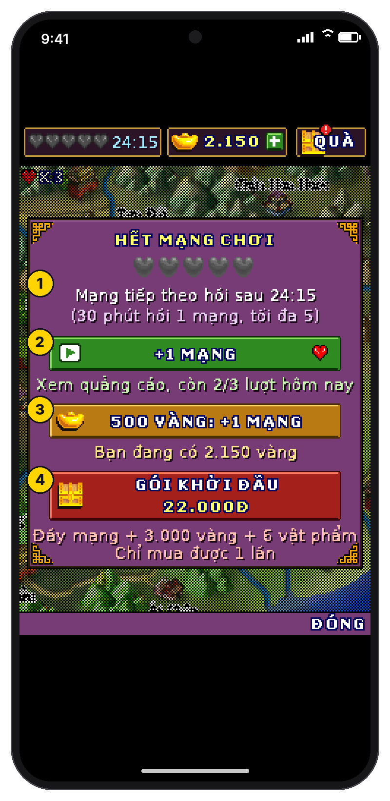
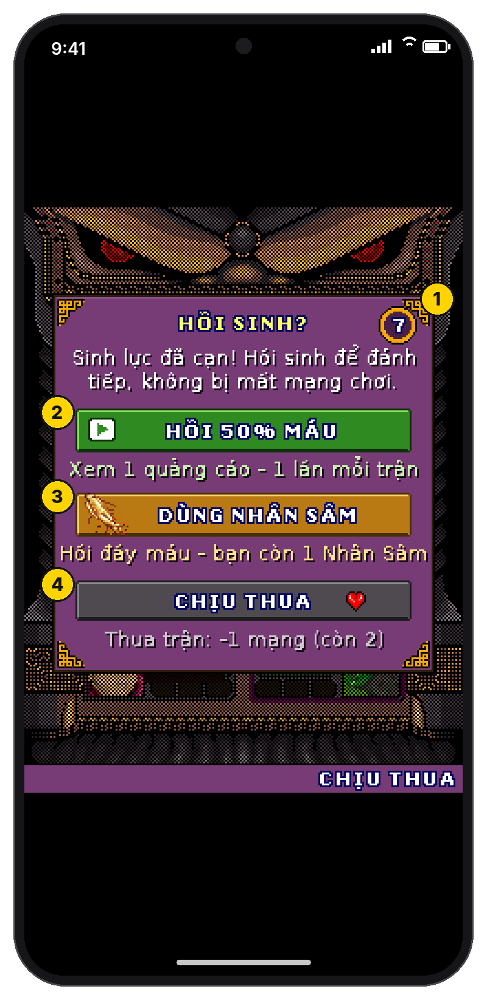
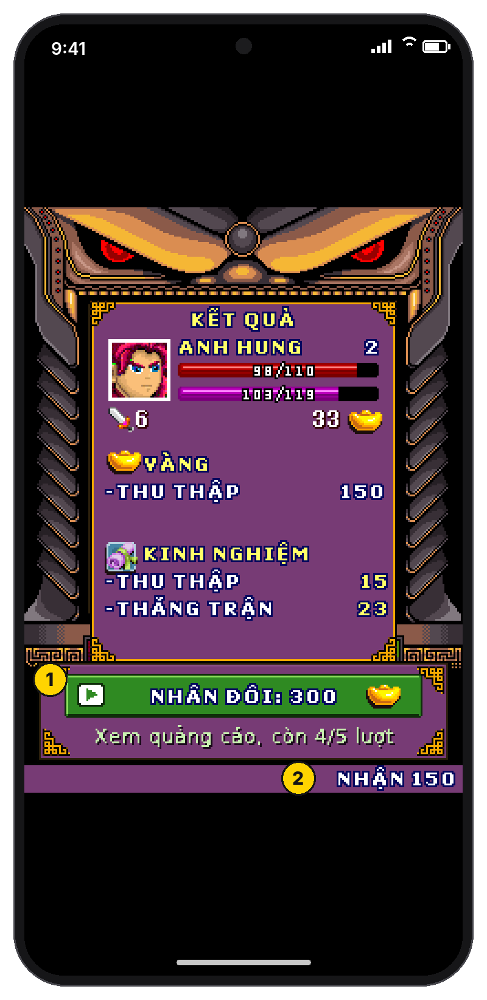
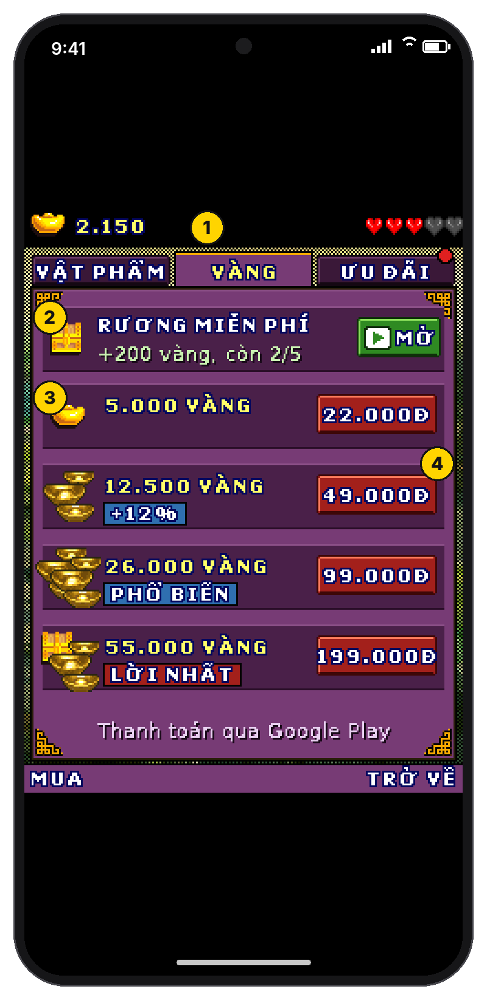
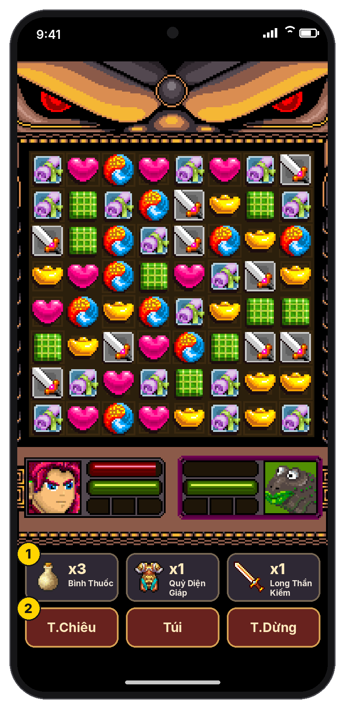
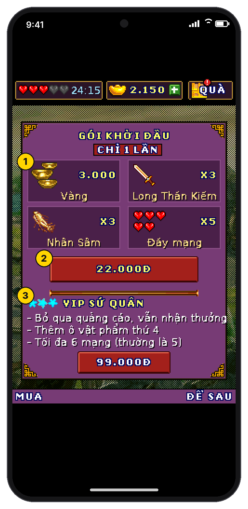
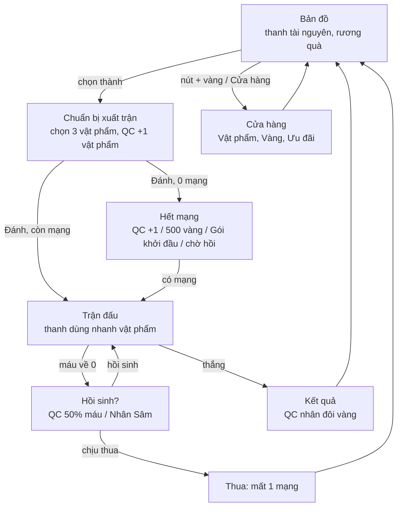

# Kế hoạch kiếm tiền: quảng cáo thưởng và mua vật phẩm

> **Trạng thái:** ý tưởng và bản nháp, **chưa code**.
>
> - Ảnh trong [`mockups/`](mockups/) là giao diện nháp. Chúng được vẽ bằng chính hình, khung và phông chữ của game; ảnh nền là màn hình thật của bản port.
> - Mọi con số (giá, giới hạn lượt, phần thưởng) chỉ là đề xuất ban đầu. Sẽ chỉnh lại khi có dữ liệu người chơi.

## Tóm tắt

- **Bản gốc chỉ thu tiền qua tin nhắn SMS:** mua vàng, Long Thần Kiếm, Nhân Sâm, mua thêm mạng, mở bảo vật. Bản Unity không gửi SMS đi, nhưng game vẫn tưởng đã gửi thành công. Vì vậy hiện tại:
  - **vật phẩm, vàng và mạng bán qua SMS đang được cho không**: bấm mua là nhận, không mất gì;
  - game **không có nguồn thu**.
- **Thay SMS bằng hai nguồn thu:**
  1. **Quảng cáo thưởng.** Người chơi tự bấm xem và biết trước mình nhận gì: thêm mạng, hồi sinh, vật phẩm trước trận, nhân đôi vàng, rương quà.
  2. **Mua trong ứng dụng qua Google Play:** gói vàng, gói khởi đầu (mua 1 lần) và VIP.
- **Mạng hồi theo thời gian.** Ai cũng chơi tiếp được mà không cần trả tiền.
- **Thêm bước "Chuẩn bị xuất trận".** Người chơi chọn tối đa 3 vật phẩm mang vào trận. Trong trận có **thanh dùng nhanh** ngay dưới bàn cờ.
- **Không có quảng cáo tự bật hay xen ngang trong trận.**

## 1. Hiện trạng (đọc từ code game gốc)

| Hạng mục | Cách hoạt động hiện nay |
|---|---|
| Mạng chơi | Lần đầu "Chơi mới" có 4 mạng; mỗi lần chơi lại từ đầu được ít hơn 1 (tối thiểu 1). Khi vào trận, game tạm trừ 1 mạng: thắng thì trả lại, thua thì mất luôn. Hết mạng thì không đánh được nữa, phải mua thêm 4 mạng bằng SMS. **Không có hồi mạng theo thời gian.** |
| Vàng | Có được khi xếp thỏi vàng trong trận và khi xong nhiệm vụ. Dùng để mua vật phẩm và trả phí vào Đấu trường. |
| Vật phẩm | Mua trong Cửa hàng (bảng dưới). Trong trận, nút **Túi** dùng được mọi vật phẩm đang có. Xếp từ 5 ô trở lên được thưởng 1 vật phẩm. |
| Sưu tập | 4 bảo vật (Kính Bát Quái, Khánh Kim Long, Ngọc Bội, Tượng Phật) nhận được khi xong một số nhiệm vụ. Muốn mở phải gửi SMS; đủ bộ thì gửi SMS để nhận "các phần quà giá trị" (lời của game). |
| Thu tiền | SMS tới đầu số `8x31` (cửa hàng và mua mạng dùng `8531`). Ngoài ra còn mục "Tặng game" (gửi SMS) và quảng cáo ứng dụng "Chat OLA". |
| Trên bản Unity hiện nay | SMS không được gửi đi, nhưng game vẫn coi như mua thành công, nên **vật phẩm, vàng và mạng bán qua SMS đang miễn phí**. Đã chạy thử: mua 3 Long Thần Kiếm khi chỉ có 45 vàng, game báo "Đã mua vật phẩm thành công", vàng vẫn còn 45. Mua mạng đi cùng đường này nên cũng miễn phí (+4 mạng mỗi lần bấm). Riêng mở bảo vật thì game chỉ báo "đã gửi tin, đang chờ phản hồi" và không mở được, vì không có tin trả về. |

Cửa hàng hiện tại:

| Vật phẩm | Tác dụng | Cách mua hiện tại |
|---|---|---|
| Long Thần Kiếm | Nhân đôi sức tấn công trong 1 lượt | Chỉ qua SMS (3 cái/tin) |
| Nhân Sâm | Nhân đôi máu cơ bản, 1 lần/trận | Chỉ qua SMS (3 cái/tin) |
| Ngân Lượng | +1.000 vàng | Chỉ qua SMS |
| Quỷ Diện Giáp | Chặn 3/4 sát thương trong 1 lượt | 1.000 vàng / 3 cái |
| Bình Thuốc | Hồi 10% máu, 1 lần/lượt | 250 vàng / 3 cái |
| Ngọc Ấn | Được đi trước, tự kích hoạt khi vào trận | 500 vàng / 3 cái |

## 2. Nguyên tắc

1. **Người chơi luôn tự chọn xem quảng cáo**, bằng nút có biểu tượng ▶ màu xanh.
   - Game ghi rõ phần thưởng trước khi xem.
   - Có giới hạn số lượt mỗi ngày.
   - Không có quảng cáo tự bật hay xen ngang, nhất là trong trận.
2. **Không trả tiền vẫn chơi hết được game.** Mạng tự hồi, vàng kiếm được khi chơi. Tiền thật chỉ giúp nhanh hơn và tiện hơn.
3. **Ba màu nút thống nhất trên mọi màn:**
   - xanh lá: xem quảng cáo, miễn phí;
   - vàng: trả bằng vàng trong game;
   - đỏ: trả tiền thật qua Google Play.
4. **Phần thưởng cố định, không quay ngẫu nhiên.** Như vậy rõ ràng với người chơi, và không phải công bố tỉ lệ theo chính sách AdMob và Google Play (xem mục 10).
5. **Tận dụng khoảng đen trên và dưới màn hình game.** Màn hình gốc có tỉ lệ 3:4 nên trên điện thoại dài luôn còn trống hai đầu.
   - Phía trên đặt **thanh tài nguyên**: mạng, vàng, rương quà.
   - Phía dưới, trong trận, đặt **thanh dùng nhanh vật phẩm** và các phím mềm.

## 3. Các điểm đặt quảng cáo thưởng

| # | Vị trí | Khi nào xuất hiện | Thưởng | Giới hạn |
|---|---|---|---|---|
| 1 | Hết mạng | Bấm "Đánh" khi còn 0 mạng, hoặc bấm vào ô mạng trên thanh tài nguyên | +1 mạng | 3 lần/ngày |
| 2 | Hồi sinh | Máu về 0 lần đầu trong trận | Hồi 50% máu, đánh tiếp, không mất mạng | 1 lần/trận |
| 3 | Chuẩn bị xuất trận | Màn chọn vật phẩm | +1 vật phẩm dùng cho trận này (chọn 1 trong Bình Thuốc, Quỷ Diện Giáp, Long Thần Kiếm) | 1 lần/trận, 10 lần/ngày |
| 4 | Thắng trận | Màn "Kết quả" | Nhân đôi số vàng nhặt được trong trận | 5 lần/ngày |
| 5 | Rương quà | Thanh tài nguyên hoặc Cửa hàng | +200 vàng | 5 lần/ngày, cách nhau ít nhất 1 giờ |
| 6 | Bảo vật (Sưu tập) | Khi nhận bảo vật sau nhiệm vụ | Mở bảo vật (thay cho SMS) | Theo số bảo vật |
| 7 | Đấu trường | Khi vào luyện tập | Miễn phí vé vào | 1 lần/ngày |

Người chơi VIP bấm các nút này thì **nhận thưởng ngay, không phải xem quảng cáo**; giới hạn lượt vẫn giữ nguyên.

## 4. Mạng chơi (thiết kế mới)

| Thông số | Đề xuất |
|---|---|
| Mạng tối đa | 5 (VIP: 6) |
| Hồi mạng | 1 mạng mỗi 30 phút, tính cả khi đã tắt game |
| Khi bắt đầu trận / thắng / thua | Giữ như bản gốc: tạm trừ 1 mạng, thắng trả lại, thua mất |
| Chơi mới | Đầy mạng. Bỏ luật "mỗi lần chơi lại bớt 1 mạng": luật này hợp với kiểu bán mạng qua SMS, không còn hợp khi mạng đã tự hồi. |
| Lấy thêm mạng | Xem quảng cáo (+1, 3 lần/ngày), đổi 500 vàng lấy 1 mạng, hoặc Gói khởi đầu (đầy mạng) |

## 5. Vật phẩm và bước "Chuẩn bị xuất trận"

**Màn mới trước mỗi trận** (thay cho hộp "đối đầu" hiện tại):

- Phần đầu vẫn hiện hai bên đối đầu như cũ.
- **3 ô "Mang vào trận".** Mỗi ô chứa một loại vật phẩm; trong trận dùng được hết số lượng của loại đó.
  - Ô thứ 4 dành cho VIP.
  - Ngọc Ấn: nếu mang theo thì tự kích hoạt khi vào trận (tiêu 1 cái).
- **Túi đồ** hiện số lượng từng loại. Loại nào đã hết thì có nút "MUA" để mua ngay bằng vàng, không phải quay về Cửa hàng.
- **Nút xem quảng cáo** để nhận 1 vật phẩm miễn phí cho trận này.
- **Gợi ý theo đối thủ.** Ví dụ: tướng đánh mạnh thì gợi ý mang Quỷ Diện Giáp; tướng nhiều máu thì gợi ý Long Thần Kiếm.

**Trong trận:** 3 món đã chọn hiện thành **nút lớn ngay dưới bàn cờ**, chạm một lần là dùng. Nút "Túi" vẫn giữ.

**Giá trong Cửa hàng sau khi bỏ SMS:**

| Vật phẩm | Giá đề xuất | Ghi chú |
|---|---|---|
| Long Thần Kiếm | 1.500 vàng / 3 cái | Trước đây chỉ mua được qua SMS |
| Nhân Sâm | 1.500 vàng / 3 cái | Trước đây chỉ mua được qua SMS. Có thêm công dụng: **hồi sinh với 100% máu** |
| Quỷ Diện Giáp | 1.000 vàng / 3 cái | Giữ nguyên |
| Bình Thuốc | 250 vàng / 3 cái | Giữ nguyên |
| Ngọc Ấn | 500 vàng / 3 cái | Giữ nguyên |
| Ngân Lượng | Bỏ khỏi ô vật phẩm | Chuyển thành các gói vàng ở tab "Vàng" |

## 6. Mua trong ứng dụng (Google Play)

| Mã sản phẩm | Nội dung | Giá tham khảo | Loại |
|---|---|---|---|
| `gold_5k` | 5.000 vàng | 22.000đ | Dùng hết |
| `gold_12k5` | 12.500 vàng (+12%) | 49.000đ | Dùng hết |
| `gold_26k` | 26.000 vàng (nhãn "Phổ biến") | 99.000đ | Dùng hết |
| `gold_55k` | 55.000 vàng (nhãn "Lời nhất") | 199.000đ | Dùng hết |
| `starter_pack` | 3.000 vàng + 3 Long Thần Kiếm + 3 Nhân Sâm + đầy mạng | 22.000đ | Chỉ mua 1 lần |
| `vip` | Bỏ qua quảng cáo mà vẫn nhận thưởng, ô vật phẩm thứ 4, tối đa 6 mạng | 99.000đ | Mua 1 lần, giữ mãi |

- Giá thật lấy từ Google Play theo từng quốc gia. Không ghi cứng giá trong game.
- Gói khởi đầu hiện **một lần** sau trận hướng dẫn, hoặc lần đầu người chơi hết mạng. Sau đó gói nằm ở tab "Ưu đãi" cho tới khi được mua.
- Không bán gì mà người chơi không kiếm được bằng cách chơi. Ngoại lệ duy nhất là các tiện ích của VIP.

## 7. Giao diện nháp

Số trong vòng tròn vàng trên ảnh ứng với các ghi chú bên dưới mỗi ảnh.

### 7.1 Bản đồ và thanh tài nguyên

1. **Mạng:** 3/5 tim, kèm đồng hồ đếm tới lần hồi mạng tiếp theo. Chạm vào thì mở hộp "Hết mạng / thêm mạng".
2. **Vàng** và nút **+**, mở Cửa hàng ở tab Vàng.
3. **Rương quà**, có chấm đỏ khi đã mở được (xem quảng cáo để mở).
4. Chỗ đặt banner quảng cáo **nếu sau này cần**. Đề xuất chưa bật: nếu bật thì chỉ ở bản đồ và menu, không có trong trận, và VIP không thấy.

### 7.2 Chuẩn bị xuất trận

1. **3 ô mang vào trận.** Chạm vật phẩm trong túi để thêm, chạm vào ô để bỏ.
2. **Ô thứ 4** dành cho VIP.
3. **Túi đồ.** Món nào đã hết thì hiện nút "MUA" để mua nhanh bằng vàng.
4. **Xem quảng cáo** nhận 1 vật phẩm cho trận này (còn 8/10 lượt hôm nay).
5. **Gợi ý** vật phẩm theo đối thủ.

### 7.3 Hết mạng

1. Đồng hồ hồi mạng: chờ thì vẫn có mạng, không cần trả tiền.
2. **Xem quảng cáo +1 mạng** (3 lần/ngày).
3. **Đổi 500 vàng lấy 1 mạng.**
4. **Gói khởi đầu** (tiền thật, chỉ 1 lần).

### 7.4 Hồi sinh khi sắp thua

1. Hộp tự đóng sau vài giây. Hết giờ thì tính là thua.
2. **Xem quảng cáo:** hồi 50% máu (1 lần/trận).
3. **Dùng Nhân Sâm:** hồi đầy máu.
4. **Chịu thua:** mất 1 mạng, như bản gốc.

### 7.5 Thắng trận: nhân đôi vàng

1. **Xem quảng cáo** để nhân đôi số vàng nhặt được (150 thành 300).
2. Không xem thì bấm "NHẬN 150" như bình thường.

### 7.6 Cửa hàng: tab Vàng

1. Ba tab: **Vật phẩm** (6 ô như cũ), **Vàng** và **Ưu đãi** (gói khởi đầu, VIP).
2. **Rương miễn phí:** xem quảng cáo nhận 200 vàng.
3. **Các gói vàng** mua bằng tiền thật.
4. Nhãn **"+12%", "Phổ biến", "Lời nhất"** giúp người chơi so sánh nhanh.

### 7.7 Trong trận: dùng nhanh vật phẩm

1. **3 món đã chọn trước trận**, chạm một lần là dùng. Số trên nút là số lượng còn lại.
2. **Phím mềm của game**, như bản hiện tại.

### 7.8 Gói khởi đầu và VIP

1. Nội dung gói: 3.000 vàng, 3 Long Thần Kiếm, 3 Nhân Sâm, đầy mạng.
2. Giá; gói chỉ mua được 1 lần.
3. **VIP:** bỏ qua quảng cáo mà vẫn nhận thưởng, thêm ô vật phẩm thứ 4, tối đa 6 mạng.

## 8. Luồng chơi có các điểm kiếm tiền

## 9. Hướng triển khai kỹ thuật (để dành khi bắt đầu code)

**Phía Unity (C#):**

- SDK quảng cáo: Google AdMob, kèm Google UMP để xin đồng ý quảng cáo; có thể dùng mediation khi lượng người chơi lớn. Mua trong ứng dụng: Unity IAP (Google Play Billing).
- Vẽ thanh tài nguyên và thanh dùng nhanh ở vùng đen ngoài màn hình 240x320. Đây là cùng cách đang vẽ các phím mềm lớn trong trận.

**Cầu nối game ↔ Unity**, thêm vào `j2me.Host`:

- `showRewarded(vị trí, kết quả)`: game tạm dừng cho tới khi có kết quả.
- `purchase(mã sản phẩm, kết quả)` và `price(mã sản phẩm)`: lấy giá đã định dạng theo quốc gia.
- `isVip()`.
- Trong bộ test Java/C#, quảng cáo và giao dịch được giả lập luôn thành công, để kiểm thử so sánh Java và C# vẫn chạy được.

**Chỗ cần sửa trong game** (vá Java rồi dịch sang C# như hiện nay):

| Việc | Chỗ trong code gốc |
|---|---|
| Bỏ SMS khi mua vật phẩm / vàng | `q` (Cửa hàng) gọi `an.a("shop", …)` |
| Bỏ SMS khi mua mạng; thay bằng hộp "Hết mạng" | `aa` (Bản đồ), nhánh 12, gọi `an.b(…)` |
| Mạng: đọc, trừ, cộng; hồi theo giờ | `bg.l / m / n / c` (bản ghi số 5), `dd.h` (bắt đầu trận), `dd.i` (thắng) |
| Hồi sinh | `bu` (trận đấu), khi máu về 0, trước hộp thua `dd.g()` |
| Chuẩn bị xuất trận | Hộp đối đầu trên bản đồ (`aa`, `bp`) |
| Mở bảo vật bằng quảng cáo thay SMS | `bg.e(n)` đang gọi `an.c("reco" + n)` |
| Đổi quà bộ sưu tập: thành phần thưởng trong game (ví dụ mở thêm mức Đấu trường, 5.000 vàng) | `dc` đang gọi `an.a(mã)` |
| "Tặng game", "Chat OLA": thay bằng "Chia sẻ" và "Đánh giá" | Menu chính (`ac`) |

**Lưu dữ liệu:** dùng PlayerPrefs như hiện nay, thêm các mục:

- thời điểm hồi mạng;
- số lượt quảng cáo đã xem trong ngày;
- trạng thái VIP và gói khởi đầu.

VIP và gói khởi đầu phải khôi phục được khi cài lại game (chức năng "khôi phục giao dịch" của Unity IAP). Nếu đồng hồ máy bị chỉnh lùi thì không hồi mạng.

**Số liệu đặt từ xa** (Remote Config) để chỉnh giá và giới hạn mà không phải ra bản mới. Theo dõi các chỉ số:

- tỉ lệ hết mạng;
- số lượt xem quảng cáo trên mỗi người mỗi ngày;
- tỉ lệ mua lần đầu;
- tỉ lệ dùng hồi sinh.

## 10. Pháp lý và chính sách cần kiểm tra trước khi bật thu tiền

- **Quyền phát hành.** Màn "Thông tin" của game ghi "Loạn 12 sứ quân v1.0, 2010 MicroGame Corp.". Trước khi bán vật phẩm hay đặt quảng cáo cần chắc chắn có quyền phát hành và kiếm tiền từ game này.
- **Google Play.**
  - Vật phẩm số trong game (tiền ảo, thêm mạng, vật phẩm…) phải bán qua hệ thống thanh toán của Google Play.
  - Nếu sau này bán rương ngẫu nhiên bằng tiền thật thì phải công bố tỉ lệ trước khi mua.
  - Nếu chọn đối tượng người chơi có trẻ em thì phải theo chính sách Gia đình (Families) và dùng SDK quảng cáo phù hợp.
- **Quảng cáo thưởng (AdMob).**
  - Chỉ hiện khi người chơi chủ động đồng ý.
  - Phải nói rõ cần làm gì và nhận gì trước khi xem.
  - Phải trao đúng phần thưởng.
  - Thưởng ngẫu nhiên thì phải công bố tỉ lệ trước. Kế hoạch này dùng thưởng cố định nên tránh được việc đó.
  - Không dùng tiền thật hay vật có thể quy đổi ra tiền làm phần thưởng.
- **Việt Nam.** Theo Nghị định 147/2024/NĐ-CP, game tải về chơi không kết nối máy chủ thuộc nhóm **G4**. Doanh nghiệp cung cấp game G2, G3, G4 cần **giấy chứng nhận** cung cấp trò chơi. Nên hỏi luật sư trước khi phát hành có thu tiền tại Việt Nam.

## 11. Lộ trình đề xuất

| Giai đoạn | Nội dung | Kết quả |
|---|---|---|
| 1 | Bỏ SMS. Mạng hồi theo giờ. Quảng cáo +1 mạng, hồi sinh, nhân đôi vàng. Cửa hàng bán gói vàng. | Game có nguồn thu; hết chuyện "mua" miễn phí qua SMS |
| 2 | Chuẩn bị xuất trận và thanh dùng nhanh. Gói khởi đầu. VIP. | Vật phẩm được dùng nhiều hơn, thêm lý do mua |
| 3 | Rương quà. Bảo vật mở bằng quảng cáo, đổi quà trong game. Vé Đấu trường. Banner (nếu cần). Tinh chỉnh theo số liệu. | Giữ chân người chơi lâu hơn |

## 12. Các điểm cần quyết định

1. **Giới hạn 3 món mang vào trận** làm thay đổi luật gốc (hiện tại dùng được mọi thứ trong Túi). Có thể chọn một trong hai:
   - giới hạn thật (có chiến thuật hơn);
   - 3 ô chỉ là dùng nhanh, Túi vẫn chứa đủ mọi thứ (nhẹ nhàng hơn).
2. **Có bật banner ở bản đồ và menu không?** Đề xuất: chưa bật.
3. **Thị trường:** chỉ Việt Nam hay cả quốc tế? Điều này ảnh hưởng tới giá, ngôn ngữ và giấy phép.
4. **Nền tảng quảng cáo:** AdMob, hay Unity LevelPlay, hay dùng mediation ngay từ đầu?
5. **Xác nhận quyền phát hành** (mục 10).

---

Nguồn tham khảo cho mục 10:

- [Google Play: Chính sách thanh toán](https://support.google.com/googleplay/android-developer/answer/9858738)
- [AdMob: Chính sách cho quảng cáo có tặng thưởng](https://support.google.com/admob/answer/7313578)
- [LuatVietnam: Trò chơi điện tử là gì? Phân loại trò chơi điện tử trên mạng (Nghị định 147/2024/NĐ-CP)](https://luatvietnam.vn/linh-vuc-khac/tro-choi-dien-tu-la-gi-883-95390-article.html)
- [PocketGamer.biz: Vietnam issues Decree 147/2024 to regulate online games](https://www.pocketgamer.biz/vietnam-issues-decree-1472024-to-regulate-online-games-and-internet-services)
