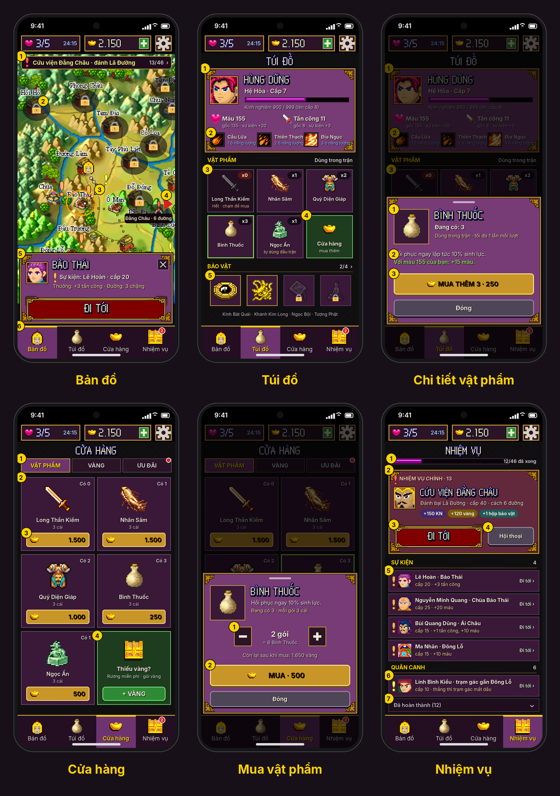
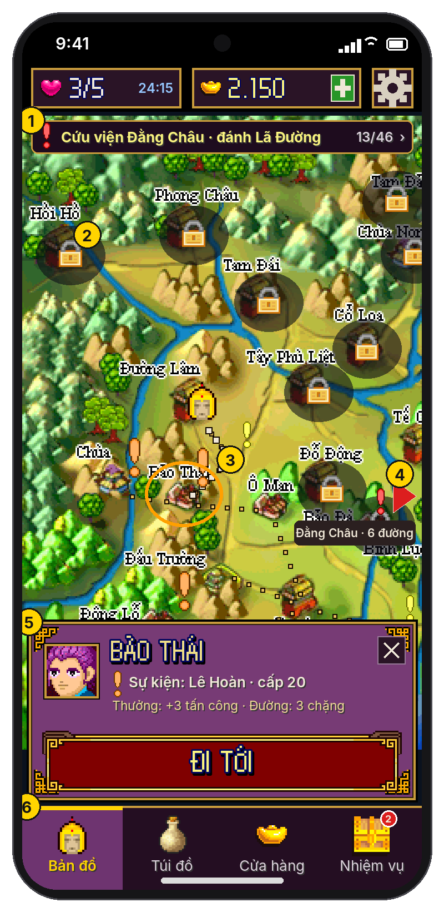
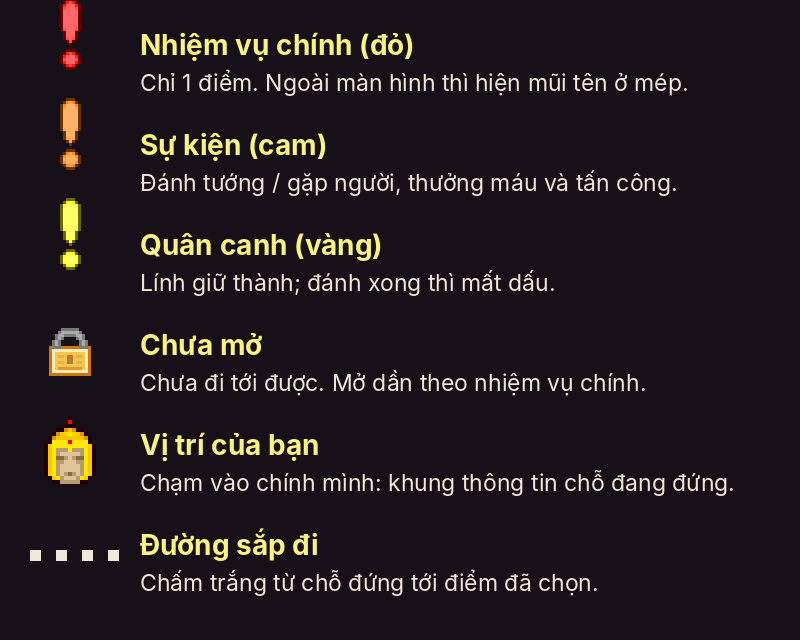
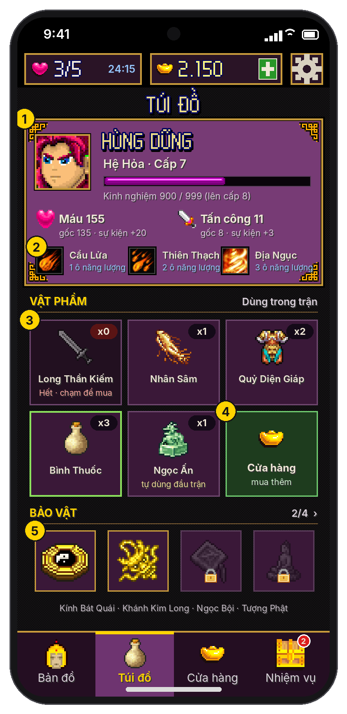
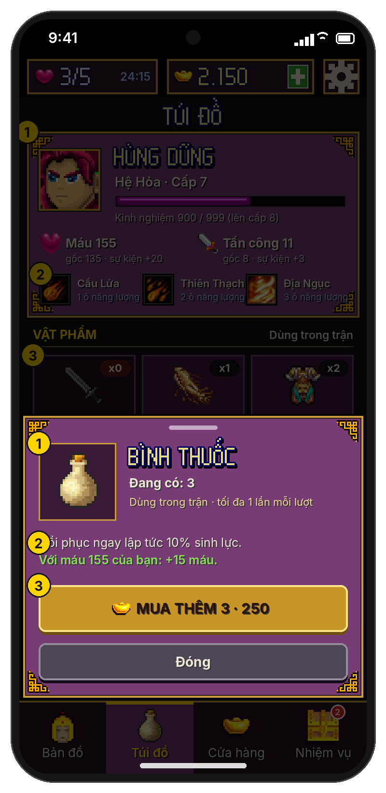
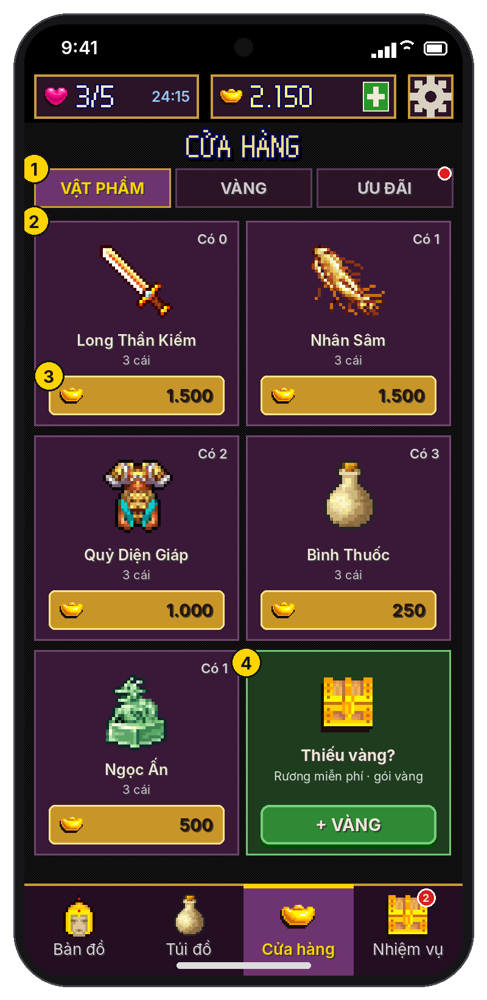
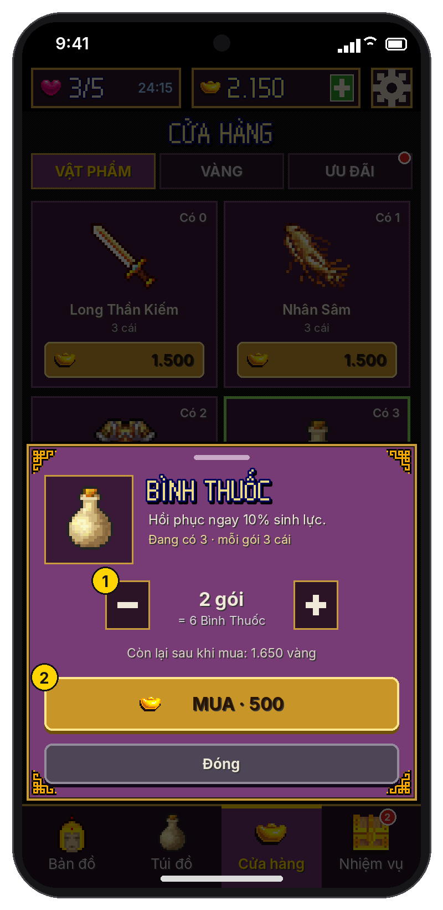
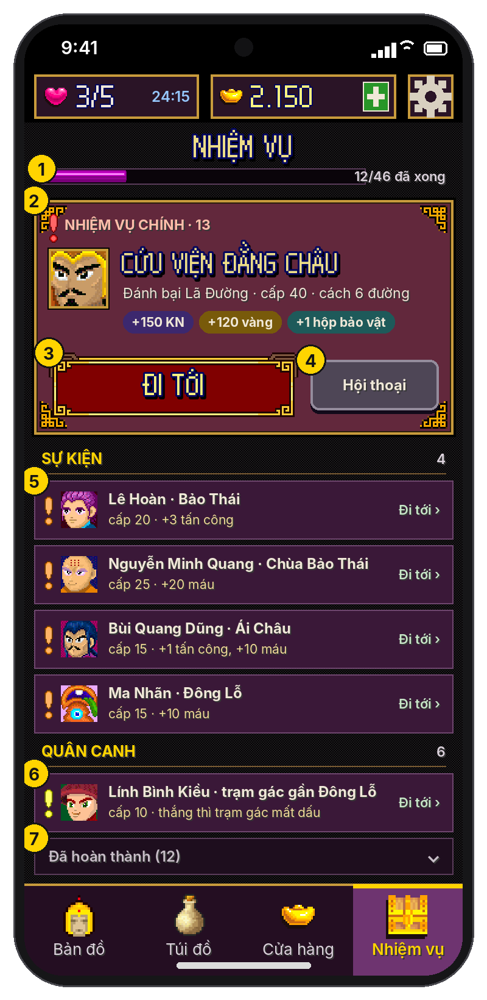

# Giao diện bản đồ: Bản đồ, Túi đồ, Cửa hàng, Nhiệm vụ

> **Trạng thái:** thiết kế để implement, **chưa code**.
>
> - Ảnh nằm trong [`ui/ban-do/`](ui/ban-do/), vẽ bằng hình gốc của game, cùng lưới và màu với [thiết kế giao diện](thiet-ke-giao-dien.md#3-bản-đồ). Tài liệu này thay phần mô tả ngắn ở mục 3 và mục 8 của tài liệu đó.
> - Ảnh nháp chụp ở **nhiệm vụ chính số 13** ("Cứu viện Đằng Châu"), người chơi đứng ở Đường Lâm. Các con số trên ảnh khớp với dữ liệu game.
> - Toạ độ ghi theo **điểm ảo** `u` (1 u = 4 px trên ảnh nháp). Mã nguồn nhắc tới là bản Java dịch ngược trên nhánh `ui-touch`.
> - Mọi dữ liệu ở đây là **của nhân vật đang chơi**, trừ vàng, vật phẩm và mạng là chung (xem [nhiều nhân vật](thiet-ke-nhieu-nhan-vat.md)).

## 1. Dữ liệu game dùng cho 4 thẻ (đọc từ code)

| Dữ liệu | Ở đâu | Nội dung |
|---|---|---|
| Nút bản đồ | `bq.a` (tên), `bq.b` (x, y, loại) | 41 nút. Loại 0 = **thành** (25 nút, đều có tên). Loại 1 = **điểm trên đường** (đồn, trạm gác, ngã rẽ); chỉ Bảo Đà và Đông Phù Liệt có tên. |
| Đường | `bq.d` = {nút A, nút B, cấp quái thấp nhất, cao nhất}; `bq.c[nút][hướng]` = đường đi theo 4 hướng | 43 đoạn đường. Đường "mở" khi cả hai đầu đã mở (`aa.A[i].c`). |
| Nút đã mở | `aa.z[i].d` | Hoa Lư mở sẵn. Xong nhiệm vụ chính `q` thì mở các nút trong `dd.m[q]` (`aa.a(int[])`). |
| Nhiệm vụ chính | `dd.l[q]` = {loại, nút, đối thủ, KN, vàng, cờ}; tiến độ `aa.T` | **46 nhiệm vụ đi lần lượt**. Loại 0 = hội thoại, 1 = trận hướng dẫn, 2 = đánh. Cờ 1 = được 1 **hộp bảo vật**, cờ 2 = hộp bảo vật cuối. Nhiệm vụ hiện tại nằm ở nút `dd.e(T)` (`aa.z[n].e = T`). Hết 46 thì sang màn kết. |
| Hội thoại | `ea.b[q]` (trước), `ea.c[q]` (sau khi thắng), `ea.d[q]` (khi thua) | Người nói là chỉ số trong `ea.a`; "00"–"05" là người chơi. |
| Sự kiện | `dd.n[e]` = {loại, nút, đối thủ, + tấn công, + máu}; `aa.z[n].f` | 8 sự kiện phụ, không theo thứ tự; làm 1 lần. Thắng sự kiện Lê Hoàn mở mức Đấu trường 3, Nguyễn Ninh mở mức 4. |
| Quân canh | `dd.p[nút]`; còn hay không `aa.S[nút]` | 14 nút có lính canh. Đánh thắng thì mất (`S = -1`). Giá trị 75 = "Lính" có cấp bằng cấp người chơi (`dd.y`). |
| Chặn đường | `aa.ae` | Cứ đi 3–10 đoạn đường thì gặp quái giữa đường (cấp trong khoảng của đoạn đó, `dd.x`). |
| Đấu trường | nút 24 (Tam Điệp), `aa.aq[0..4]` | Mức 1, 2 mở sẵn; mức 3, 4 do sự kiện; mức 5 khi cấp ≥ 30. |
| Tướng | `dd.e` (lớp `c`): `e` cấp, `b` máu tối đa, `c` máu, `d` tấn công, `f[3]` tuyệt chiêu, `g` máu cộng thêm, `h` tấn công cộng thêm | Máu gốc = `100 + 5 × cấp` + chỉ số riêng của tướng; tấn công gốc = `cấp / 2 + 5` + chỉ số riêng (`dd.w`, `dd.v`, bảng `dd.o`). |
| Kinh nghiệm | 16b #103 (`dd.b()`) | Tổng tích luỹ. Cần `dd.u(L) = 16·L² − 25` để đạt cấp `L`. |
| Ví và túi đồ | 161b #9 (chung, `acct_161b`) | Chỉ số 2 là vàng; 0, 1, 3, 4, 5 là số vật phẩm. |
| Vật phẩm | `h.c` (tên), `h.d` (mô tả), `q.c` (số cái mỗi gói), `PortUi.PRICE` | Xem mục 4. |
| Bảo vật | 161b #1–#3 (`bg.s()`) | 4 bảo vật, nhận dần qua hộp bảo vật. |

Phụ lục A, B, C ở cuối tài liệu liệt kê đủ 46 nhiệm vụ, 8 sự kiện và 14 quân canh.

## 2. Khung chung của 4 thẻ

| Vùng | Nội dung |
|---|---|
| Thanh trên (luôn hiện) | Mạng `n/5` và đồng hồ hồi mạng · vàng và nút **+** (mở Cửa hàng, tab Vàng) · nút ⚙ (mở hộp Tạm dừng) |
| Giữa | Nội dung của thẻ đang chọn |
| Thanh điều hướng (cao 37 u) | 4 ô bằng nhau: Bản đồ · Túi đồ · Cửa hàng · Nhiệm vụ. Ô đang chọn nền tím (110,52,112), vạch vàng trên đầu, chữ vàng. |

Quy tắc:

1. Cả 4 thẻ đều là **lớp vẽ đè lên màn bản đồ của game** (`aa` vẫn là màn hiện tại). Đổi thẻ không tạo màn mới trong game, không ghi save.
2. Mỗi thẻ **giữ trạng thái** khi rời đi: vị trí cuộn, tab con, thẻ đang mở rộng. Ra Menu rồi vào lại thì về mặc định.
3. **Nút Back Android:** đang có khung trượt thì đóng khung; đang ở thẻ khác thì về thẻ Bản đồ; đang ở Bản đồ thì mở hộp Tạm dừng.
4. **Đang đi trên đường mà đổi thẻ:** thẻ mới mở ngay; nhân vật đi hết đoạn đường đang đi rồi dừng (xoá phần đường còn lại, `portPathLen = 0`). Nếu giữa đoạn đó gặp quái chặn đường thì tự về thẻ Bản đồ và hiện hộp đối đầu.
5. **Không đổi thẻ được** khi game đang mở hội thoại, hộp đối đầu, màn kết quả hay hộp thông báo. Lúc đó thanh điều hướng mờ 50%.
6. **Chấm đỏ:**
   - Nhiệm vụ: hiện **số mục mới** chưa xem = nhiệm vụ chính mới (khi `T` tăng) + sự kiện mới mở + quân canh mới mở. Mở thẻ Nhiệm vụ thì xoá về 0.
   - Túi đồ: chấm không số khi có **hộp bảo vật chưa mở**.
   - Cửa hàng: chấm không số khi rương vàng miễn phí đã sẵn sàng (theo [kế hoạch kiếm tiền](README.md#3-các-điểm-đặt-quảng-cáo-thưởng)).
7. **Hộp Tạm dừng** (nút ⚙): Tiếp tục · Âm thanh bật/tắt · Hướng dẫn bản đồ · Về menu. "Về menu" ghi save bản đồ (`aa.w()`) rồi thoát, thay cho hộp "Bạn có muốn trở về menu hay không?" của game.

## 3. Thẻ Bản đồ

### 3.1 Hiển thị bản đồ

- Ảnh bản đồ gốc `/m/m` (380×380). Phóng theo **số nguyên**: `tỉ lệ = floor(chiều rộng màn px / 240)` (720 px → x3, 1080 px → x4, 1440 px → x6). Như vậy màn rộng luôn thấy khoảng 240 px bản đồ.
- Chiều dọc: ở x3, cả bản đồ (1.140 px) gần như vừa vùng giữa; phần thừa tô màu nền (10,18,30).
- **Camera** đi theo nhân vật, kẹp trong mép bản đồ. Kéo một ngón để cuộn ngang và dọc, có quán tính; thả tay xong 3 giây không chạm thì camera trượt về nhân vật (0.4 giây). Không có phóng to / thu nhỏ.
- Chạm vào **chính nhân vật**: mở khung thông tin của nút đang đứng.

### 3.2 Các lớp vẽ (từ dưới lên)

| Lớp | Vẽ gì | Khi nào |
|---|---|---|
| 1 | Ảnh bản đồ | Luôn luôn |
| 2 | **Thành chưa mở**: phủ tối hình bầu dục 31×27 u (đen 60%) và biểu tượng khoá `/m/lock` x3 | Nút loại 0 mà `z[n].d = false` |
| 3 | **Đường đã mở**: các ô vuông vàng (230,190,90) 2 u, cách nhau 6.5 u | Mọi đường có `A[i].c = true` |
| 4 | **Đường sắp đi**: ô vuông trắng 3 u, cách nhau 5 u, từ chỗ đứng tới điểm đã chọn (đường ngắn nhất, giống `aa.a(x, y)`) | Khi đã chọn một nút khác chỗ đứng |
| 5 | **Dấu hiệu** (`/m/mt1`, 3 dấu chấm than 7×24 có sẵn 3 màu): đỏ = nhiệm vụ chính, cam = sự kiện, vàng = quân canh. Đặt lệch phải trên nút. Nút có nhiều thứ thì chỉ vẽ dấu ưu tiên cao nhất (đỏ > cam > vàng). | Nút đã mở có nội dung |
| 6 | Vòng chọn: elip viền cam (255,160,0) dày 1.5 u | Nút đang chọn |
| 7 | Nhân vật `/m/hm` x4, đứng trên nút hoặc chạy dọc đường | Luôn luôn |
| 8 | **Mũi tên ngoài màn**: tam giác đỏ viền trắng ở mép màn, hướng về nhiệm vụ chính, kèm nhãn "{nơi} · {n} đường" | Nhiệm vụ chính nằm ngoài vùng đang thấy |

Ghi chú ảnh 3:

1. **Thanh theo dõi nhiệm vụ** (172×15 u, ngay dưới thanh trên): dấu đỏ, tên nhiệm vụ chính (phụ lục A) và tên đối thủ nếu là trận đánh, bên phải "{T+1}/46 ›".
   - Chạm: camera trượt tới nút của nhiệm vụ và mở khung thông tin nút đó.
   - Ẩn khi đã xong cả 46 nhiệm vụ.
2. **Thành chưa mở**: chạm vào thì hiện thông báo ngắn 2 giây "Chưa mở. Làm tiếp nhiệm vụ chính để mở vùng này." Không mở khung thông tin.
3. **Đường sắp đi** từ Đường Lâm tới Bảo Thái.
4. **Mũi tên** chỉ về Đằng Châu (nhiệm vụ chính), cách 6 đoạn đường. Chạm mũi tên = chạm thanh theo dõi.
5. **Khung thông tin nút** (mục 3.3).
6. Thanh điều hướng; ô Nhiệm vụ có chấm đỏ số 2.

### 3.3 Khung thông tin nút

Khung tím viền vàng sát trên thanh điều hướng, cao 82 u, nút ✕ ở góc phải trên. Mở khi chạm một nút đã mở (vùng chạm bán kính 11 u quanh nút, lấy nút gần nhất). Chạm chỗ trống trên bản đồ hoặc ✕ thì đóng và bỏ "đường sắp đi".

Nội dung theo thứ tự ưu tiên của nút:

| Nút có | Dòng 1 (pixel) | Dòng 2 | Dòng 3 | Chân dung | Nút chính |
|---|---|---|---|---|---|
| Nhiệm vụ chính | Tên nơi | ❗đỏ "Nhiệm vụ: {tiêu đề}" | Đánh: "{đối thủ} · cấp {n}"; luôn có "Thưởng: {KN} KN · {vàng} vàng" (+ "· hộp bảo vật") | Đối thủ (đánh) hoặc người nói đầu tiên (hội thoại) | ĐI TỚI / BẮT ĐẦU |
| Sự kiện | Tên nơi | ❗cam "Sự kiện: {đối thủ} · cấp {n}" (hội thoại: "Sự kiện: gặp gỡ") | "Thưởng: +{a} tấn công, +{h} máu" · "Đường: {n} chặng" | Đối thủ | ĐI TỚI / BẮT ĐẦU |
| Quân canh | Tên nơi (điểm không tên: "Trạm gác") | ❗vàng "Quân canh: {tên lính} · cấp {n}" | "Thắng để dẹp trạm gác" · "Đường: {n} chặng" | Lính | ĐI TỚI / BẮT ĐẦU |
| Đấu trường (Tam Điệp, sau nhiệm vụ 5) | TAM ĐIỆP | "Đấu trường · {m}/5 mức đã mở" | "Luyện kinh nghiệm, mất vé vào" | — | ĐI TỚI / VÀO |
| Không có gì | Tên nơi | "Không có nhiệm vụ" | "Đường: {n} chặng" | — | ĐI TỚI (mờ nếu đang đứng đó) |

- **"Đường: n chặng"** = số đoạn đường trên đường ngắn nhất. Đứng tại chỗ thì không hiện.
- **ĐI TỚI**: đi theo đường ngắn nhất (chức năng sẵn có `aa.a(x, y)` → `portWalk()`). Khung thu lại thành dải mỏng "Đang đi tới {nơi}… · Dừng" (14 u). "Dừng" = dừng ở cuối đoạn đang đi.
- **Tới nơi**: game tự mở hội thoại / hộp đối đầu như bản gốc (`aa.e(B)` → `f(2)`), không cần bấm thêm.
- **BẮT ĐẦU / VÀO**: thay cho ĐI TỚI khi đang đứng tại nút đó và nút còn nội dung (ví dụ vừa rút lui khỏi trận). Gọi lại đúng bước game làm khi vừa tới nơi.
- Nút không tới được (không có đường đã mở): ĐI TỚI mờ, dòng 3 ghi "Chưa có đường tới".

### 3.4 Đang đi

- Mỗi đoạn đường game chạy như bản gốc (tốc độ, hướng). Nhân vật quay mặt theo hướng đi.
- **Gặp quái chặn đường** (bộ đếm `ae` về 0): dừng đường đi, hiện hộp đối đầu như hiện nay. Sau trận (thắng hoặc rút lui), **không** tự đi tiếp; khung thông tin của điểm đích mở lại với nút ĐI TỚI.
- Chạm một nút khác khi đang đi: đổi đích, đi tiếp từ cuối đoạn hiện tại.

### 3.5 Hướng dẫn bản đồ (lần đầu và trong hộp Tạm dừng)

Thay hộp chữ cũ ("bấm các phím 2, 4, 6, 8") bằng 3 bước chỉ tay, mỗi bước một câu, chạm để qua:

1. "Dấu đỏ là nhiệm vụ chính. Chạm vào thành để xem." (chỉ vào nút nhiệm vụ)
2. "Bấm ĐI TỚI, tướng sẽ tự đi theo đường." (chỉ vào nút ĐI TỚI)
3. "Dấu cam là sự kiện phụ, dấu vàng là quân canh. Xem hết ở thẻ Nhiệm vụ." (chỉ vào ô Nhiệm vụ)

Hiện tự động 1 lần cho mỗi nhân vật, lúc lần đầu vào bản đồ sau cốt truyện mở đầu.

## 4. Thẻ Túi đồ

Thay cho phím mềm "T.Tin" của bản gốc. Cuộn dọc nếu không đủ chỗ.

1. **Thẻ tướng** (172×96 u):
   - chân dung x4; tên; "Hệ {Hỏa|Lôi|Thủy} · Cấp {e}";
   - thanh kinh nghiệm (`/m/lv`), tính trong cấp hiện tại: `(KN − u(e)) / (u(e+1) − u(e))`; dòng dưới "Kinh nghiệm {KN} / {u(e+1)} (lên cấp {e+1})";
   - **Máu** `b` với dòng nhỏ "gốc {b − g} · sự kiện +{g}"; **Tấn công** `d` với "gốc {d − h} · sự kiện +{h}". Bỏ dòng nhỏ nếu phần cộng thêm bằng 0.
2. **3 tuyệt chiêu** của tướng (`dd.e.f`): biểu tượng 15 u, tên, "{1|2|3} ô năng lượng" (`PortUi.skillCost`). Chạm: khung trượt có mô tả `h.b[id]`, thay "=" bằng sát thương thật (`PortUi` đã có cách tính).
3. **Vật phẩm**: lưới 3 cột, 5 ô theo thứ tự Long Thần Kiếm, Nhân Sâm, Quỷ Diện Giáp, Bình Thuốc, Ngọc Ấn (không có Ngân Lượng, vì đó là vàng).
   - Mỗi ô: hình 24 u, nhãn "x{n}" góc phải trên, tên.
   - Hết (n = 0): hình xám, nhãn nền đỏ, dòng "Hết · chạm để mua".
   - Ngọc Ấn: dòng "tự dùng đầu trận".
   - Ô thứ 6 xanh lá "Cửa hàng · mua thêm" → sang thẻ Cửa hàng, tab Vật phẩm.
   - Dòng tiêu đề bên phải ghi "Dùng trong trận": vật phẩm không dùng được trên bản đồ (đúng game gốc).
4. Chạm vật phẩm: mở khung chi tiết (mục 4.1).
5. **Bảo vật**: 4 ô (Kính Bát Quái, Khánh Kim Long, Ngọc Bội, Tượng Phật, hình `/r/1`–`/r/4`). Có thì sáng, viền vàng; chưa có thì xám kèm khoá. Tiêu đề phải "{số có}/4 ›" → mở màn Sưu tập. Có hộp bảo vật chưa mở thì thêm một ô "Hộp bảo vật ×{n}" trước 4 ô này, chạm để mở (bằng quảng cáo, theo kế hoạch kiếm tiền).

### 4.1 Chi tiết vật phẩm

1. Hình 40 u, tên, "Đang có: {n}", giới hạn dùng (bảng dưới).
2. Mô tả `h.d[t]`, và **một dòng tính sẵn cho tướng hiện tại** (bảng dưới, chữ xanh lá).
3. Nút vàng **"MUA THÊM {gói} · {giá}"**: mua ngay 1 gói (như mục 5.2, không hỏi lại). Thiếu vàng thì nút xám "Thiếu {x} vàng" và chạm vào mở Cửa hàng tab Vàng.
- "Đóng", chạm ra ngoài hoặc Back: đóng.

| Vật phẩm | Giới hạn dùng | Dòng tính sẵn |
|---|---|---|
| Long Thần Kiếm | 1 lượt | "Tấn công lượt đó: {d} → {2d}" |
| Nhân Sâm | 1 lần mỗi trận | "Máu trận đó: {b} → {2b}" |
| Quỷ Diện Giáp | 1 lượt | "Chặn 3/4 sát thương của lượt địch" |
| Bình Thuốc | 1 lần mỗi lượt | "Với máu {b} của bạn: +{floor(b/10)} máu" |
| Ngọc Ấn | tự dùng khi bắt đầu trận | "Bạn luôn được đi trước" |

## 5. Thẻ Cửa hàng

Thay cho màn Cửa hàng cũ (`q`, lưới 6 ô và hộp "Có / Không"). Vàng là **ví chung** của mọi nhân vật.

1. **3 tab**: Vật phẩm · Vàng · Ưu đãi. Tab Vàng và Ưu đãi theo [kế hoạch kiếm tiền](README.md#76-cửa-hàng-tab-vàng) (gói vàng, rương miễn phí, gói khởi đầu, VIP). Chấm đỏ trên tab khi có thứ miễn phí.
2. **Thẻ vật phẩm** 84×84 u, 2 cột: hình 35 u, "Có {n}" góc phải trên, tên, "{gói} cái", nút giá.
   - Nút giá vàng (200,150,40) khi đủ tiền; xám khi thiếu.
   - Chạm **bất kỳ chỗ nào** trên thẻ: mở khung Mua (mục 5.1).
3. Giá hiện tại (`PortUi.PRICE`, gói `q.c`): Long Thần Kiếm 1.500, Nhân Sâm 1.500, Quỷ Diện Giáp 1.000, Bình Thuốc 250, Ngọc Ấn 500, mỗi gói 3 cái. Giá có thể chỉnh từ xa (Remote Config), nên UI luôn đọc từ `PortUi.price(t)`.
4. Ô cuối **"Thiếu vàng?"** (xanh lá): chạm → tab Vàng.

### 5.1 Khung Mua

1. **Chọn số gói** bằng nút − / + (24×24 u). Mặc định 1, tối thiểu 1, tối đa = số gói mua được bằng vàng hiện có (ít nhất 1 để vẫn xem được giá) và không quá 10. Giữ nút + để tăng liên tục (mỗi 0.15 giây). Dòng dưới: "= {gói × 3} {tên}", "Còn lại sau khi mua: {vàng − tổng}".
2. Nút vàng **"MUA · {tổng}"**. Thiếu vàng: nút xanh lá "+ VÀNG (thiếu {x})" → tab Vàng.
- "Đóng", chạm ra ngoài, Back: đóng.

### 5.2 Khi bấm mua

1. Gọi `PortUi.buy(t, số gói)` (mục 8). Hàm kiểm tra đủ vàng cho **cả lượt mua** trước khi trừ; thiếu thì không mua gói nào.
2. Thành công: số vàng trên thanh trên chạy giảm trong 0.4 giây; "Có {n}" nhảy số; hình vật phẩm bay vào ô Túi đồ trên thanh điều hướng; rung nhẹ. Khung Mua đóng.
3. Không còn hộp "Đã mua vật phẩm thành công" của game.

## 6. Thẻ Nhiệm vụ

1. **Tiến độ**: thanh `/m/lv` rộng 133 u, "{T}/46 đã xong".
2. **Nhiệm vụ chính** (thẻ đỏ sẫm (98,40,60), cao 96 u):
   - dòng nhỏ "❗ NHIỆM VỤ CHÍNH · {T+1}";
   - chân dung đối thủ (trận đánh) hoặc người nói đầu tiên trong `ea.b[T]` (hội thoại); tiêu đề lớn (phụ lục A);
   - dòng phụ: trận đánh "Đánh bại {đối thủ} · cấp {n} · cách {k} đường"; hội thoại "Gặp {người nói} tại {nơi} · cách {k} đường";
   - các nhãn thưởng: "+{KN} KN" (tím), "+{vàng} vàng" (vàng), "+1 hộp bảo vật" (xanh ngọc). Không có thưởng thì bỏ nhãn.
3. **ĐI TỚI**: về thẻ Bản đồ, camera trượt tới nút, rồi bắt đầu đi luôn (như bấm ĐI TỚI trong khung thông tin). Đang đứng ở đó thì là **BẮT ĐẦU**.
4. **Hội thoại**: xem lại đoạn thoại mở đầu `ea.b[T]` bằng màn [Hội thoại cốt truyện](thiet-ke-giao-dien.md#4-hội-thoại-cốt-truyện), chỉ để đọc, không đổi tiến độ.
5. **Sự kiện**: danh sách sự kiện ở **nút đã mở** mà chưa làm (`z[n].f ≥ 0`). Mỗi dòng 166×24 u: dấu cam, chân dung x2, "{đối thủ} · {nơi}", "cấp {n} · {thưởng}", "Đi tới ›". Sắp xếp theo số chặng đường, gần trước. Chạm cả dòng = Đi tới.
6. **Quân canh**: như Sự kiện, cho các nút đã mở còn lính canh (`S[n] ≥ 0`). Điểm không tên ghi "trạm gác gần {thành gần nhất}". Lính cấp theo người chơi ghi "cấp {cấp của bạn}".
7. **Đã hoàn thành ({T})**: thu gọn mặc định; mở ra là danh sách nhiệm vụ 1…T (mới nhất trên cùng), mỗi dòng có dấu ✓, tiêu đề, nơi và nút "Hội thoại" để đọc lại (`ea.b`, rồi `ea.c`).

- Mục nào rỗng thì ẩn cả tiêu đề mục.
- **Mục mới** (từ lần mở thẻ trước) có nhãn "MỚI" màu đỏ ở đầu dòng trong lần mở này.
- Đã xong cả 46: thẻ nhiệm vụ chính thành "Đã thống nhất giang sơn!" kèm nút "Xem lại kết thúc".

## 7. Lưu dữ liệu mới

Theo nhân vật (đặt trong store của ô, ví dụ bản ghi mới 16b #120, chuỗi JSON):

| Khoá | Dùng cho |
|---|---|
| `seenT` | `T` lúc mở thẻ Nhiệm vụ lần cuối |
| `seenEvents`, `seenGuards` | Danh sách nút sự kiện / quân canh đã thấy |
| `mapTutorialDone` | Đã xem hướng dẫn bản đồ 3 bước |

Không lưu trạng thái cuộn, tab con hay vị trí camera.

## 8. Cầu nối game ↔ Unity (thêm vào `PortUi`)

Unity chỉ đọc qua các hàm này và gửi hành động qua `PortUi.request(kind, arg)` như các màn đã làm (đối đầu, trận đấu, kết quả).

**Đọc:**

| Hàm | Trả về |
|---|---|
| `mapNodeCount()`, `mapNodeX/Y(n)`, `mapNodeType(n)`, `mapNodeName(n)` | Dữ liệu `bq` |
| `mapNodeOpen(n)`, `mapRoadOpen(r)`, `mapRoadEnds(r)` | `aa.z[n].d`, `aa.A[r].c` |
| `mapPlayerNode()`, `mapPlayerX/Y()`, `mapWalking()`, `mapWalkTarget()` | `aa.B`, `aa.F/G`, đang đi hay không, đích đang đi |
| `mapNodeContent(n)` | 0 không có, 1 nhiệm vụ chính, 2 sự kiện, 3 quân canh, 4 đấu trường |
| `mapRoadsTo(n)` | Số đoạn đường ngắn nhất từ chỗ đứng (−1 nếu không tới được) |
| `questIndex()`, `questCount()` | `aa.T`, 46 |
| `questType(q)`, `questNode(q)`, `questEnemy(q)`, `questEnemyLevel(q)`, `questExp(q)`, `questGold(q)`, `questRelic(q)`, `questSpeaker(q)` | Bảng `dd.l`, `ea.b` |
| `eventList()`, `eventNode(e)`, `eventEnemy(e)`, `eventAttack(e)`, `eventHp(e)` | Sự kiện còn lại ở nút đã mở |
| `guardList()`, `guardEnemy(n)`, `guardLevel(n)` | Quân canh còn lại ở nút đã mở |
| `heroExp()`, `heroExpFor(level)`, `heroBonusHp()`, `heroBonusAttack()` | 16b #103, `dd.u`, `dd.e.g`, `dd.e.h` |
| `relicOwned(i)`, `relicBoxes()` | Bảo vật đã có, số hộp chưa mở |

**Hành động** (thêm vào hằng số đầu `PortUi`):

| Hằng | `arg` | Làm gì |
|---|---|---|
| `MAP_GO` | nút | Đi tới nút (dùng lại `aa.a(x, y)` / `portWalk`) |
| `MAP_STOP` | — | Dừng ở cuối đoạn đang đi |
| `MAP_START` | — | Chạy lại bước "vừa tới nơi" ở nút đang đứng (`aa.y()`) |
| `MAP_MENU` | — | Ghi save bản đồ rồi về Menu |
| `SHOP_BUY` | `t * 100 + số gói` | Mua; trả kết quả qua `PortUi.lastBuyOk()` |

Tiêu đề 46 nhiệm vụ (phụ lục A) là **chuỗi mới**, đặt trong bảng `PortUi.QUEST_TITLE[46]`.

## 9. Kiểm thử chấp nhận

1. Bản đồ: nút chưa mở có khoá, chạm hiện thông báo; mở dần đúng như cột "Mở thêm" của phụ lục A.
2. Chạm một thành xa → hiện đường trắng đúng đường ngắn nhất, số chặng khớp; bấm ĐI TỚI → tới nơi thì hội thoại / đối đầu tự mở như bản gốc.
3. Giữa đường gặp quái → hộp đối đầu; sau trận không tự đi tiếp, khung thông tin điểm đích mở lại.
4. Đang đi mà mở thẻ Túi đồ → nhân vật dừng ở cuối đoạn, không đi tiếp.
5. Thanh theo dõi và mũi tên ngoài màn luôn chỉ đúng nút của nhiệm vụ `T`; hết 46 thì ẩn.
6. Túi đồ: số máu, tấn công, kinh nghiệm khớp màn "Thông tin" cũ của game ở cùng save.
7. Cửa hàng: mua 3 gói Bình Thuốc với đúng 750 vàng → còn 0 vàng, có thêm 9 cái; thử mua khi thiếu 1 vàng → không mất gì.
8. Vàng và vật phẩm mua ở nhân vật A hiện đúng ở nhân vật B.
9. Nhiệm vụ: danh sách Sự kiện, Quân canh khớp các dấu cam, vàng trên bản đồ; làm xong một sự kiện thì mất khỏi cả hai nơi.
10. Chấm đỏ Nhiệm vụ: xong một nhiệm vụ chính mở thêm 2 thành có sự kiện → chấm "3" (1 nhiệm vụ mới + 2 sự kiện); mở thẻ → mất chấm, các dòng mới có nhãn "MỚI".
11. Back Android theo đúng quy tắc mục 2.3 ở mọi thẻ.
12. Máy 16:9 (cao 320 u): Túi đồ cuộn được; khung thông tin bản đồ vẫn không che nhân vật (camera đẩy nhân vật lên trên khung).

## 10. Cần quyết định

| # | Câu hỏi | Mặc định trong tài liệu |
|---|---|---|
| B1 | Có cho phóng to / thu nhỏ bản đồ không? | Không. Một mức theo số nguyên để pixel sắc nét. |
| B2 | Đổi thẻ khi đang đi: dừng hay đi tiếp ngầm? | Dừng ở cuối đoạn đang đi. |
| B3 | Tiêu đề nhiệm vụ: dùng 46 tiêu đề viết tay (phụ lục A) hay tự sinh "Đánh bại X / Gặp X"? | Viết tay; dòng phụ vẫn tự sinh. |
| B4 | Mua tối đa bao nhiêu gói một lần? | 10. |

---

## Phụ lục A. 46 nhiệm vụ chính

Tiêu đề do tài liệu này đặt, dựa trên câu thoại mở đầu của từng nhiệm vụ. Các cột khác lấy nguyên từ `dd.l`, `dd.m`, `dd.o`, `bq.a`.

| # | Tiêu đề hiển thị | Loại | Nơi (nút) | Đối thủ · cấp | Thưởng | Mở thêm |
|---|---|---|---|---|---|---|
| 1 | Học binh pháp với Lưu Cơ | Đánh (hướng dẫn) | Hoa Lư (0) | Lưu Cơ · 1 | 30 KN, 10 vàng | — |
| 2 | Nhận lệnh hộ tống chủ tướng | Hội thoại | Hoa Lư (0) | — | — | Kỳ Bố |
| 3 | Hộ tống chủ tướng về Kỳ Bố | Hội thoại | Kỳ Bố (1) | — | 40 KN, 20 vàng, hộp bảo vật | — |
| 4 | Bàn việc xưng hiệu | Hội thoại | Hoa Lư (0) | — | — | Tam Điệp |
| 5 | Dẹp sơn tặc ở Tam Điệp | Đánh | Tam Điệp (24) | Sơn Tặc · 7 | 50 KN, 30 vàng, hộp bảo vật | — |
| 6 | Dự đại lễ xưng Vạn Thắng Vương | Hội thoại | Hoa Lư (0) | — | — | Đằng Châu |
| 7 | Kết hòa ước với Phạm Bạch Hổ | Hội thoại | Đằng Châu (3) | — | 70 KN, 50 vàng, hộp bảo vật | — |
| 8 | Bàn kế đánh Bình Kiều | Hội thoại | Hoa Lư (0) | — | — | Ái Châu, Đông Lỗ, Bình Kiều |
| 9 | Đánh chiếm Bình Kiều | Đánh | Bình Kiều (2) | Ngô Xương Xí · 20 | 100 KN, 80 vàng, hộp bảo vật | — |
| 10 | Chọn hướng tiến quân | Hội thoại | Hoa Lư (0) | — | — | Đường Lâm, Ô Man, Bảo Thái, Chùa Bảo Thái |
| 11 | Đánh Ngô Nhật Khánh | Đánh | Đường Lâm (8) | Ngô Nhật Khánh · 30 | 150 KN, 120 vàng, hộp bảo vật | — |
| 12 | Nhận tin Lã Đường đánh Đằng Châu | Hội thoại | Đường Lâm (8) | — | — | Tế Giang |
| 13 | Cứu viện Đằng Châu | Đánh | Đằng Châu (3) | Lã Đường · 40 | 150 KN, 120 vàng, hộp bảo vật | — |
| 14 | Bàn kế đánh Tế Giang | Hội thoại | Đằng Châu (3) | — | — | Trà Hương |
| 15 | Phá quân canh Tế Giang | Đánh | trạm gác gần Tế Giang (27) | Lính Tế Giang · 25 | 50 KN, 50 vàng | — |
| 16 | Diệt Lã Đường ở Tế Giang | Đánh | Tế Giang (5) | Lã Đường · 40 | 200 KN, 150 vàng, hộp bảo vật | — |
| 17 | Từ biệt Phạm Bạch Hổ | Hội thoại | Đằng Châu (3) | — | — | Đỗ Động, Bình Lục |
| 18 | Phá đồn Bảo Đà | Đánh | Bảo Đà (đồn) (25) | Lính Đỗ Động · 30 | 50 KN, 50 vàng | — |
| 19 | Bắt Đỗ Cảnh Thạc | Đánh | Đỗ Động (4) | Đỗ Cảnh Thạc · 50 | 300 KN, 170 vàng, hộp bảo vật | — |
| 20 | Củng cố Đỗ Động | Hội thoại | Đỗ Động (4) | — | — | Tây Phù Liệt |
| 21 | Giữ thành Đỗ Động | Đánh | Đỗ Động (4) | Nguyễn Trí Khả · 45 | 400 KN, 200 vàng, hộp bảo vật | — |
| 22 | Bàn kế đánh Tây Phù Liệt | Hội thoại | Đỗ Động (4) | — | — | — |
| 23 | Hỏi tội Nguyễn Trí Khả | Đánh | Tây Phù Liệt (7) | Nguyễn Trí Khả · 45 | 500 KN, 250 vàng | — |
| 24 | Diệt Nguyễn Siêu | Đánh | Đông Phù Liệt (đồn) (26) | Nguyễn Siêu · 60 | 700 KN, 300 vàng, hộp bảo vật | — |
| 25 | Bàn kế phá liên minh | Hội thoại | Tây Phù Liệt (7) | — | — | — |
| 26 | Cứu viện Ô Man | Đánh | Ô Man (18) | Tàn Tướng Đỗ Động · 40 | 900 KN, 350 vàng, hộp bảo vật | — |
| 27 | Chuẩn bị đánh Siêu Loại | Hội thoại | Tế Giang (5) | — | — | Siêu Loại, Trà Hương |
| 28 | Đánh vào Siêu Loại | Đánh | Siêu Loại (6) | Lính Siêu Loại · 45 | 1200 KN, 450 vàng | Dương Xá |
| 29 | Đuổi bắt Lý Khuê | Đánh | Dương Xá (19) | Lý Khuê · 70 | 1500 KN, 500 vàng, hộp bảo vật | — |
| 30 | Xuất binh đánh Tiên Du | Hội thoại | Siêu Loại (6) | — | — | Tiên Du |
| 31 | Đánh Nguyễn Thủ Tiệp | Đánh | Tiên Du (10) | Nguyễn Thủ Tiệp · 80 | 1800 KN, 550 vàng, hộp bảo vật | — |
| 32 | Bàn kế đánh Cổ Loa | Hội thoại | Tiên Du (10) | — | — | Cổ Loa, Chùa Non nước, Tam Đảo |
| 33 | Phá quân canh Cổ Loa | Đánh | trạm gác gần Chùa Non nước (28) | Lính Cổ Loa · 55 | 1600 KN, 500 vàng, hộp bảo vật | — |
| 34 | Đánh Lữ Xử Bình ở Cổ Loa | Đánh | Cổ Loa (9) | Lữ Xử Bình · 90 | 2100 KN, 600 vàng, hộp bảo vật | — |
| 35 | Bàn kế đánh Tam Đái | Hội thoại | Cổ Loa (9) | — | — | Tam Đái |
| 36 | Phá quân canh Tam Đái | Đánh | trạm gác gần Đường Lâm (39) | Lính Tam Đái · 60 | 1800 KN, 500 vàng | — |
| 37 | Đánh Nguyễn Khoan ở Tam Đái | Đánh | Tam Đái (11) | Nguyễn Khoan · 70 | 2500 KN, 650 vàng, hộp bảo vật | — |
| 38 | Nhận tin Kỳ Bố bị vây | Hội thoại | Tam Đái (11) | — | — | Phong Châu |
| 39 | Giải vây Kỳ Bố | Đánh | Kỳ Bố (1) | Phản Tướng · 60 | 3000 KN, 750 vàng, hộp bảo vật | — |
| 40 | Bàn kế đánh Hồi Hồ | Hội thoại | Phong Châu (12) | — | — | Hồi Hồ |
| 41 | Phá quân canh Hồi Hồ | Đánh | trạm gác gần Hồi Hồ (30) | Lính Hồi Hồ · 75 | 2500 KN, 500 vàng | — |
| 42 | Đánh Kiều Công Hãn | Đánh | Hồi Hồ (13) | Kiều Công Hãn · 95 | 4000 KN, 850 vàng, hộp bảo vật | — |
| 43 | Đánh Kiều Thuận | Đánh | Hồi Hồ (13) | Kiều Thuận · 99 | 5000 KN, 950 vàng, hộp bảo vật | — |
| 44 | Bàn việc xưng đế | Hội thoại | Hồi Hồ (13) | — | — | — |
| 45 | Diệt Ấu Rồng ở Hoa Lư | Đánh | Hoa Lư (0) | Ấu Rồng · 96 | hộp bảo vật (cuối) | — |
| 46 | Lễ lên ngôi Đinh Tiên Hoàng | Hội thoại | Hoa Lư (0) | — | — | — |

## Phụ lục B. 8 sự kiện

| # | Nơi | Loại | Đối thủ · cấp | Thưởng | Ghi chú |
|---|---|---|---|---|---|
| 1 | Đông Lỗ (23) | Đánh | Ma Nhãn · 15 | +10 máu |  |
| 2 | Bảo Thái (16) | Đánh | Lê Hoàn · 20 | +3 tấn công | mở mức Đấu trường 3 |
| 3 | Chùa Bảo Thái (15) | Đánh | Nguyễn Minh Quang · 25 | +20 máu |  |
| 4 | Bình Lục (14) | Đánh | Nguyễn Ninh · 30 | +2 tấn công, +20 máu | mở mức Đấu trường 4 |
| 5 | Ái Châu (22) | Đánh | Bùi Quang Dũng · 15 | +1 tấn công, +10 máu |  |
| 6 | Trà Hương (17) | Hội thoại | — | +3 tấn công |  |
| 7 | Chùa Non nước (20) | Hội thoại | — | — |  |
| 8 | Tam Đảo (21) | Đánh | Nhện Tinh · 93 | +3 tấn công, +50 máu |  |

## Phụ lục C. 14 quân canh

| Nút | Nơi | Quân canh · cấp |
|---|---|---|
| 25 | Bảo Đà (đồn) | Lính Đỗ Động · 30 |
| 26 | Đông Phù Liệt (đồn) | Lính · theo cấp người chơi |
| 27 | trạm gác gần Tế Giang | Lính Tế Giang · 25 |
| 28 | trạm gác gần Chùa Non nước | Lính Cổ Loa · 55 |
| 30 | trạm gác gần Hồi Hồ | Lính Hồi Hồ · 75 |
| 31 | trạm gác gần Đông Lỗ | Lính Bình Kiều · 10 |
| 32 | trạm gác gần Hoa Lư | Lính · theo cấp người chơi |
| 33 | trạm gác gần Kỳ Bố | Lính · theo cấp người chơi |
| 34 | trạm gác gần Đằng Châu | Lính · theo cấp người chơi |
| 35 | trạm gác gần Tây Phù Liệt | Lính Phong Châu · 65 |
| 36 | trạm gác gần Đường Lâm | Lính · theo cấp người chơi |
| 37 | trạm gác gần Đằng Châu | Lính Siêu Loại · 45 |
| 38 | trạm gác gần Siêu Loại | Lính Tiên Du · 40 |
| 39 | trạm gác gần Đường Lâm | Lính Tam Đái · 60 |
