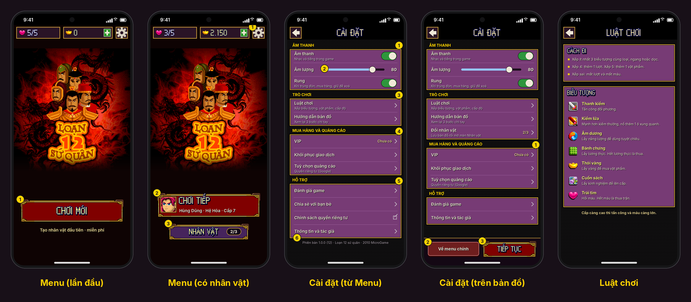
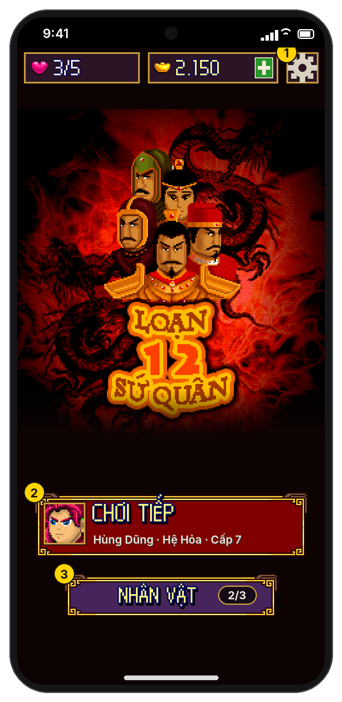
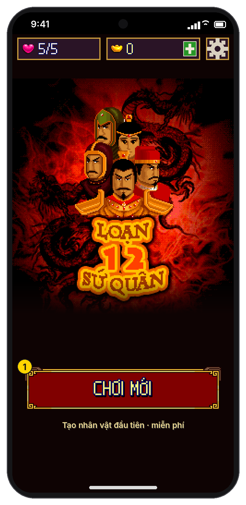
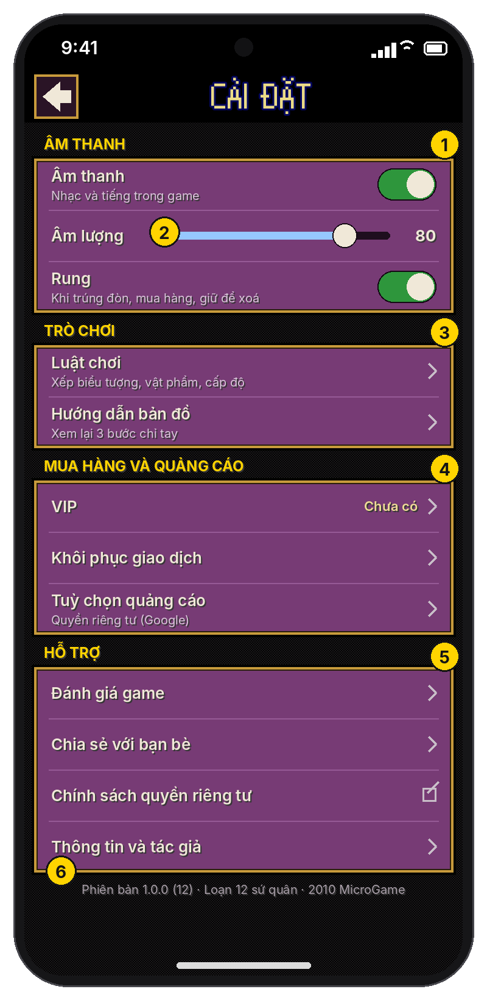
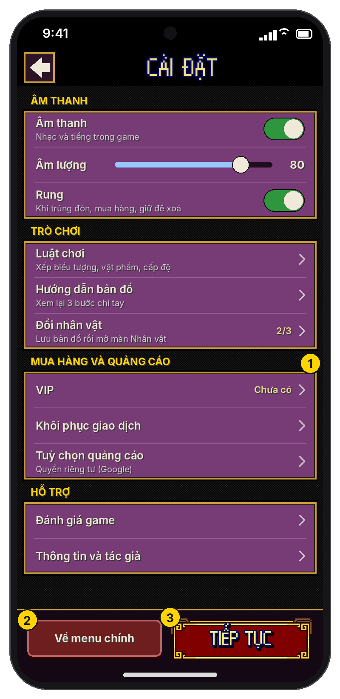
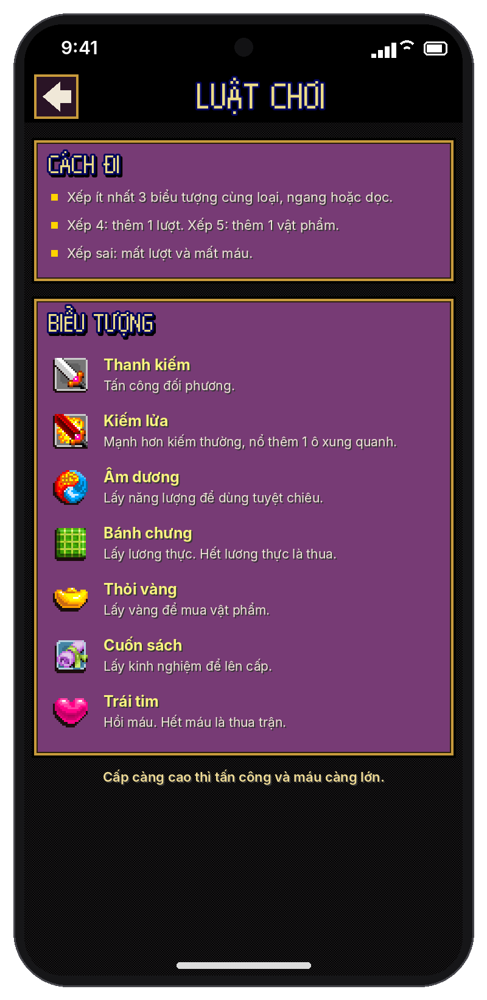

# Menu chính gọn lại và màn Cài đặt

> **Trạng thái:** thiết kế để implement, **chưa code**.
>
> - Ảnh nằm trong [`ui/cai-dat/`](ui/cai-dat/), vẽ bằng hình gốc của game, cùng lưới và màu với [thiết kế giao diện](thiet-ke-giao-dien.md).
> - Toạ độ ghi theo **điểm ảo** `u` (1 u = 4 px trên ảnh nháp). Mã nguồn nhắc tới là bản Java dịch ngược trên nhánh `ui-touch`.

## 1. Menu chính: bỏ hàng lối tắt

Bỏ hẳn hàng 4 nút **Cửa hàng · Sưu tập · Hướng dẫn · Cài đặt** ở đáy Menu chính. Menu chỉ còn thanh trên và 1–2 nút lớn.

 

1. **Nút ⚙ trên thanh trên** (18×18 u, góc phải): mở màn Cài đặt (mục 2).
2. **CHƠI TIẾP** (160×37 u) dời xuống, cách đáy vùng an toàn 75 u.
3. **NHÂN VẬT n/3** (125×25 u) ngay dưới, cách 10 u. Lần đầu (chưa có nhân vật) chỉ có **CHƠI MỚI** (160×35 u) và dòng "Tạo nhân vật đầu tiên · miễn phí".

- Ảnh bìa (`/bksplashscreen` x3) dời xuống 16 u cho cân với khoảng trống mới; mép dưới ảnh mờ dần vào nền (14,3,3) trong 27 u.
- Các nút khác của thanh trên giữ nguyên: chạm ô **mạng** mở hộp Hết mạng / thêm mạng; nút **+** cạnh vàng mở **Cửa hàng** (tab Vàng).

Những thứ bị bỏ khỏi Menu chuyển về đâu:

| Trước ở Menu | Bây giờ |
|---|---|
| Cửa hàng | Thẻ Cửa hàng trên [bản đồ](thiet-ke-ban-do.md#5-thẻ-cửa-hàng). Từ Menu: nút **+** cạnh vàng mở cùng màn Cửa hàng ở dạng trang riêng (nút quay lại thay cho thanh điều hướng). |
| Sưu tập | Mục Bảo vật trong thẻ [Túi đồ](thiet-ke-ban-do.md#4-thẻ-túi-đồ) (bảo vật là của từng nhân vật, nên đặt trong game hợp hơn). |
| Hướng dẫn | Cài đặt → Trò chơi → **Luật chơi** (mục 2.4). |
| Cài đặt | Nút ⚙ trên thanh trên. |
| Thông tin, Tác giả | Cài đặt → Hỗ trợ → **Thông tin và tác giả** (mục 2.5). |

## 2. Màn Cài đặt

Một trang riêng, mở từ nút ⚙ ở **Menu chính** hoặc trên **bản đồ** (thay cho hộp Tạm dừng trước đây). Nội dung chia nhóm, mỗi nhóm là khung tím viền vàng (không có hoa văn góc), mỗi dòng cao 21 u, có vạch ngăn giữa các dòng. Trang cuộn dọc nếu không đủ chỗ.

- Thanh trên: nút quay lại 18×18 u và tiêu đề "CÀI ĐẶT" phông pixel.
- Quay lại / Back Android: đóng trang. Mọi thay đổi **lưu ngay** khi chạm, không có nút "Lưu".
- Tiêu đề nhóm: chữ HD đậm 6 u, màu vàng (255,212,0), cách lề 8 u.

### 2.1 Mở từ Menu chính

1. **Âm thanh**
   - **Âm thanh** (công tắc): bật/tắt toàn bộ nhạc và tiếng (`cx.x`, các lệnh `setMute(!cx.x)` ở `cf`, `dk`). Thay cho màn âm thanh (`v`, "Mở / Tắt" và mức âm lượng) lúc mở game.
   - **Rung** (công tắc, mới): rung nhẹ khi trúng đòn mạnh, mua hàng thành công, giữ nút xoá nhân vật. Mặc định bật.
2. **Âm lượng** (thanh kéo 0–100, bước 5, số bên phải): `cx.y`, lưu bằng `bg.d(n)` (16b #11) như màn âm thanh cũ (`v`). Vùng chạm cao 24 u; chạm chỗ nào trên thanh thì nhảy tới đó. Thả tay thì phát tiếng "chọn" một lần ở mức mới. Tắt âm thanh thì thanh này mờ và không kéo được.
3. **Trò chơi**
   - **Luật chơi ›**: mở trang Luật chơi (mục 2.4).
   - **Hướng dẫn bản đồ ›**: chạy lại 3 bước chỉ tay của [bản đồ](thiet-ke-ban-do.md#35-hướng-dẫn-bản-đồ-lần-đầu-và-trong-cài-đặt). Từ Menu (chưa ở bản đồ): dòng mờ, ghi chú "Mở khi đang ở bản đồ".
4. **Mua hàng và quảng cáo**
   - **VIP**: bên phải "Chưa có ›" (chạm mở Cửa hàng tab Ưu đãi) hoặc "Đang có" (không chạm được).
   - **Khôi phục giao dịch ›**: như nút cùng tên ở tab Ưu đãi.
   - **Tuỳ chọn quảng cáo ›** (dòng phụ "Quyền riêng tư (Google)"): mở form quyền riêng tư của Google UMP. **Chỉ hiện** khi UMP báo cần hiện mục này (`PrivacyOptionsRequirementStatus == Required`, thường là người chơi ở châu Âu).
5. **Hỗ trợ**
   - **Đánh giá game ›**: mở hộp đánh giá trong ứng dụng của Google Play (In-App Review). Nếu Google Play không hiện hộp thì mở trang game trên Play Store.
   - **Chia sẻ với bạn bè ›**: bảng chia sẻ của Android, nội dung "Chơi Loạn 12 Sứ Quân cùng mình: {link Play Store}".
   - **Chính sách quyền riêng tư** (biểu tượng mở ngoài): mở trang chính sách trên trình duyệt. Cần có trang này trước khi phát hành (Google Play và AdMob bắt buộc).
   - **Thông tin và tác giả ›**: mở trang mục 2.5.
6. Dòng cuối: "Phiên bản {versionName} ({versionCode}) · Loạn 12 sứ quân · 2010 MicroGame". Chạm 7 lần liên tiếp: hiện mã người chơi ẩn danh để gửi hỗ trợ (không hiện email hay thông tin cá nhân).

### 2.2 Mở trên bản đồ

Game **tạm dừng** khi trang mở (không chạy tiếp đường đi, đồng hồ hồi mạng vẫn chạy). Khác bản từ Menu:

1. Nhóm Trò chơi thêm dòng **Đổi nhân vật › {n}/3**: ghi save bản đồ (`aa.w()`), về Menu rồi mở ngay màn [Nhân vật](thiet-ke-nhieu-nhan-vat.md#43-màn-nhân-vật). Nhóm Hỗ trợ chỉ còn Đánh giá game, Thông tin và tác giả.
2. **Thanh dưới cố định** (cao 42 u, vạch vàng phía trên): nút **Về menu chính** (đỏ sẫm (110,30,30), 79×21 u). Chạm: ghi save bản đồ rồi về Menu (hành động `MAP_MENU`). Không hỏi lại, vì save được ghi trước khi thoát.
3. Nút **TIẾP TỤC** (đỏ khung vàng, 90×25 u): đóng trang, game chạy tiếp. Back Android và nút quay lại cũng như vậy.

### 2.3 Mở trong trận đấu

Nút tạm dừng của trận đấu giữ hộp Tạm dừng riêng như [thiết kế trận đấu](thiet-ke-giao-dien.md#6-trận-đấu-đã-sửa-theo-góp-ý) (tiếp tục, thoát trận). Hộp đó thêm một nút **Cài đặt** mở trang này **chỉ với nhóm Âm thanh**.

### 2.4 Luật chơi

Lấy từ hộp "Hướng dẫn" của Menu cũ (`ac.F()`), viết lại thành 2 khung cho dễ đọc. Nội dung giữ đúng luật của game.

- **Cách đi**: xếp ít nhất 3 biểu tượng cùng loại, ngang hoặc dọc · xếp 4 được thêm 1 lượt, xếp 5 được thêm 1 vật phẩm · xếp sai mất lượt và mất máu.
- **Biểu tượng** (hình gốc x3, tên đậm màu kem, một câu giải thích):

| Hình | Tên | Giải thích |
|---|---|---|
| `/sword` | Thanh kiếm | Tấn công đối phương. |
| `/swordred` | Kiếm lửa | Mạnh hơn kiếm thường, nổ thêm 1 ô xung quanh; xếp chung được với kiếm thường. |
| `/yinyang` | Âm dương | Lấy năng lượng để dùng tuyệt chiêu. |
| `/rice` | Bánh chưng | Lấy lương thực. Lương thực tiêu hao mỗi lượt của đối phương; hết là thua. |
| `/gold` | Thỏi vàng | Lấy vàng để mua vật phẩm. |
| `/book` | Cuốn sách | Lấy kinh nghiệm để lên cấp. |
| `/heart` | Trái tim | Hồi máu. Hết máu là thua trận. |

- Dòng cuối: "Cấp càng cao thì tấn công và máu càng lớn."
- Câu "Tình tiết, cốt truyện và tên nhân vật phụ dựa vào sự kiện Loạn 12 Sứ Quân thế kỷ X" của game gốc chuyển sang trang Thông tin.

### 2.5 Thông tin và tác giả

Trang chữ, dùng đúng nội dung `h.f` của game gốc, mỗi mục là tiêu đề đậm và các dòng tên:

- Loạn 12 sứ quân v1.0 · 2010 MicroGame Corp.
- Kịch bản và âm thanh: Nguyễn Tuấn Dũng
- Lập trình: Lê Trung Trung, Hồng Xuân Viên
- Đồ hoạ: Nguyễn Duy Biểu, Vũ Hà Thanh
- Kiểm định: Nguyễn Văn Quang
- Thêm mục mới: "Bản chuyển sang Unity · {năm}" và câu ghi chú lịch sử ở mục 2.4.
- Bỏ dòng "Thông tin và hỗ trợ: Http://PhuThoBay.Pro" của bản gốc (trang không còn).

> Trước khi phát hành vẫn cần xác nhận quyền phát hành với chủ sở hữu game (xem [kế hoạch kiếm tiền](README.md#10-pháp-lý-và-chính-sách-cần-kiểm-tra-trước-khi-bật-thu-tiền)).

## 3. Lưu dữ liệu

Tất cả là **chung cho mọi nhân vật** (`acct_16b` hoặc PlayerPrefs riêng):

| Khoá | Giá trị | Mặc định | Ghi chú |
|---|---|---|---|
| `cx.x` → `l12.soundOn` | bật/tắt | bật | Trước đây hỏi mỗi lần mở game, không lưu |
| 16b #11 (`bg.d`) | 0–100 | 80 | Như cũ, chuyển sang `acct_16b` |
| `l12.vibrate` | bật/tắt | bật | Mới |
| `l12.mapTutorial` | — | — | Đã ở thiết kế bản đồ (theo nhân vật) |

Lúc mở game: đọc `l12.soundOn` rồi gán `cx.x`, **bỏ qua màn hỏi âm thanh** (đi thẳng vào Menu).

## 4. Chỗ cần sửa trong code

| Việc | Chỗ |
|---|---|
| Bỏ màn âm thanh lúc mở game | Màn `v` (hình `/_sound`, "Mở / Tắt") đang mở trước Menu: gán `cx.x`, `cx.y` từ lưu trữ rồi đi thẳng vào Menu `ac` |
| Bỏ các mục Cửa hàng, Sưu tập, Hướng dẫn, Thông tin, Tác giả, Chat OLA, Game khác, Tặng game khỏi Menu | `ac` (danh sách mục chọn `this.v`). Unity vẽ Menu mới nên chỉ cần không gọi các mục này |
| Âm lượng | Dùng lại `cx.y` và `bg.d` (màn `v`) |
| Tạm dừng trên bản đồ | Thay hộp "Bạn có muốn trở về menu hay không?" (`aa`, phím mềm "Thoát") bằng trang Cài đặt bản bản đồ |
| Đánh giá, chia sẻ, quyền riêng tư, UMP | Phía Unity (Google Play In-App Review, Android share intent, `Application.OpenURL`, UMP), không qua game |

## 5. Kiểm thử chấp nhận

1. Menu không còn hàng 4 lối tắt; vẫn vào được Cửa hàng (nút + vàng), Sưu tập (Túi đồ), Luật chơi và Thông tin (Cài đặt).
2. Tắt âm thanh, tắt game, mở lại: không còn hỏi, game im lặng; bật lại thì phát nhạc ngay.
3. Kéo âm lượng về 0 và lên 100: âm lượng đổi tức thì, mở lại game vẫn giữ.
4. Trên bản đồ: mở Cài đặt khi đang đi → nhân vật đứng yên; TIẾP TỤC → đi tiếp. "Về menu chính" → vào lại "Chơi tiếp" đúng chỗ cũ.
5. "Đổi nhân vật" trên bản đồ → save được ghi, màn Nhân vật mở, chọn nhân vật khác chơi được.
6. Tuỳ chọn quảng cáo chỉ hiện ở vùng UMP yêu cầu.
7. Đánh giá game không lỗi khi Google Play từ chối hiện hộp (vẫn mở được trang Play Store).

## 6. Cần quyết định

| # | Câu hỏi | Mặc định trong tài liệu |
|---|---|---|
| C1 | Có cần trang Chính sách quyền riêng tư riêng không? | Có, bắt buộc khi có quảng cáo và mua hàng. Cần một địa chỉ web. |
| C2 | Thêm chọn ngôn ngữ? | Chưa, chỉ tiếng Việt (phụ thuộc quyết định thị trường trong kế hoạch kiếm tiền). |
| C3 | Hướng dẫn bản đồ khi mở từ Menu | Mờ, ghi "Mở khi đang ở bản đồ". |
