# Thiết kế lại giao diện cho điện thoại cảm ứng (toàn màn hình)

> **Trạng thái:** đã code trên nhánh `ui-touch` các màn 1–3 và 5–12 (Menu, Nhân vật, Chọn tướng, Bản đồ, Túi đồ, Cửa hàng, Nhiệm vụ, Chuẩn bị, Trận đấu, Kết quả, Cài đặt), qua `PortUi`, `PortScreens`, `PortMap`. Còn màn cũ: Hội thoại cốt truyện (4), Nhập tên (bàn phím hệ thống), Đấu trường. Quảng cáo thưởng đang giả lập; mua bằng tiền thật chưa nối Google Play.
>
> - Đây là **tài liệu tổng**: nguyên tắc chung, danh sách màn, luồng màn hình. Chi tiết từng phần nằm ở các tài liệu con (mục "Tài liệu chi tiết").
> - Ảnh vẽ bằng chính hình nhân vật, bàn cờ, bản đồ, khung và phông chữ pixel của game. Chữ nhỏ trong ảnh nháp dùng phông HD (Inter); bản cài đặt dùng Galmuri9 làm đậm (mục "Phông chữ").

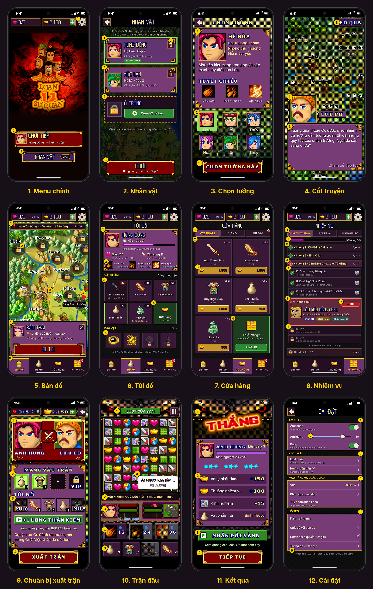

## Mục tiêu

- **Dùng hết màn hình dọc.** Không còn khung 240x320 tỉ lệ 3:4 với hai dải đen trên và dưới.
- **Chơi hoàn toàn bằng chạm.** Không cần phím mềm hay bàn phím ảo.
- **Nút lớn, nằm trong tầm ngón cái.** Hành động chính luôn ở nửa dưới màn hình.
- **Giữ chất game gốc.** Nhân vật, bàn cờ, bản đồ và khung viền vẫn là đồ họa pixel gốc.
- **Chữ dễ đọc.** Tiêu đề và nút dùng phông pixel của game; chữ nhỏ dùng phông pixel có đủ dấu tiếng Việt.

## Tài liệu chi tiết

| Tài liệu | Nội dung |
|---|---|
| [Nhiều nhân vật](thiet-ke-nhieu-nhan-vat.md) | Menu chính với 3 ô nhân vật, tạo thêm bằng quảng cáo, xoá, lưu theo ô; vàng, vật phẩm, mạng dùng chung |
| [Giao diện bản đồ](thiet-ke-ban-do.md) | 4 thẻ Bản đồ, Túi đồ, Cửa hàng (Vật phẩm, Vàng, Ưu đãi), Nhiệm vụ (Chính tuyến, Sự kiện, Quân canh); 46 nhiệm vụ |
| [Menu chính và Cài đặt](thiet-ke-cai-dat.md) | Menu không còn lối tắt; màn Cài đặt từ Menu, bản đồ, trận đấu; Luật chơi; Thông tin |
| [Kế hoạch kiếm tiền](README.md) | Quảng cáo thưởng, mua trong ứng dụng, mạng hồi theo giờ, VIP |

## Nguyên tắc bố cục

1. **Lưới 180 điểm ảo theo chiều ngang** (viết `u`), phóng to theo số nguyên để pixel luôn sắc nét:
   - x4 trên màn rộng 720 px;
   - x6 trên màn rộng 1080 px;
   - x8 trên màn rộng 1440 px.

   Chiều cao co giãn theo từng máy. Phần dư được dồn cho nội dung ở giữa (bản đồ cao hơn, khoảng cách rộng hơn), không chừa dải đen.
2. **Ba vùng cố định:**

   | Vùng | Nội dung |
   |---|---|
   | Trên | Thanh tài nguyên: mạng và đồng hồ hồi mạng, vàng và nút **+**, nút **⚙** (Cài đặt). Màn phụ: nút quay lại và tiêu đề. |
   | Giữa | Nội dung chính: bản đồ, bàn cờ, danh sách, thẻ thông tin |
   | Dưới | Hành động chính; trong game là **thanh điều hướng 4 thẻ**: Bản đồ · Túi đồ · Cửa hàng · Nhiệm vụ |

3. **Hành động chính luôn là nút đỏ khung vàng lớn nhất màn** (khung `/m/ff` của game), ở đáy màn hình. Ví dụ: "Chơi tiếp", "Chọn tướng này", "Đi tới", "Xuất trận", "Tiếp tục".
4. **Hai kiểu hộp**, cùng khung tím viền vàng của game, nền phía sau tối 65%:
   - **Hộp giữa màn** (canh giữa theo chiều dọc vùng giữa): chi tiết vật phẩm, mua, chi tiết nhiệm vụ, thông báo, xác nhận ngắn.
   - **Khung trượt từ dưới lên**: khung thông tin thành trên bản đồ (để không che bản đồ), hộp mở lượt tạo và hộp xoá ở màn Nhân vật.
   - Cả hai: chạm ra ngoài hoặc Back để đóng.
5. **Kích thước chạm tối thiểu khoảng 48dp** (24 u). Nút chính cao 30–40 u.
6. **Màu nút thống nhất với [kế hoạch kiếm tiền](README.md):**
   - đỏ khung vàng (khung của game): hành động chính;
   - xanh lá có biểu tượng ▶: miễn phí, xem quảng cáo;
   - vàng (200,150,40): trả bằng vàng trong game;
   - đỏ phẳng viền hồng (176,28,28): trả tiền thật qua Google Play, chữ là giá theo quốc gia;
   - xám: lựa chọn phụ.
7. **Quay lại** bằng nút góc trên hoặc nút Back của Android. Trong game: Back đóng hộp đang mở → về thẻ Bản đồ → mở Cài đặt. Ở Menu: hỏi trước khi thoát game.
8. **Tránh vùng "tai thỏ".** Vùng an toàn (safe area) của từng máy được chừa trống.
9. **Chấm đỏ** trên nút hoặc thẻ khi có việc mới: số đếm cho Nhiệm vụ, chấm không số cho Túi đồ (hộp bảo vật chưa mở) và Cửa hàng (rương miễn phí sẵn sàng).

## Các màn hình

Số trong vòng tròn vàng trên ảnh ứng với ghi chú trong tài liệu chi tiết. Dòng "Trước" mô tả bản game gốc.

### 1. Menu chính
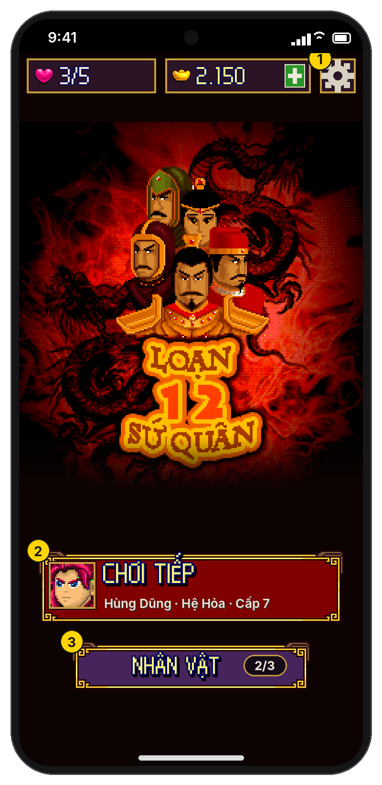

- Thanh trên: mạng, vàng (+), nút ⚙ mở Cài đặt.
- **"CHƠI TIẾP"** kèm chân dung, tên, hệ, cấp của nhân vật đang chơi; dưới là **"NHÂN VẬT n/3"**. Lần đầu chỉ có **"CHƠI MỚI"**.
- Không còn hàng lối tắt: Cửa hàng ở trong game và nút + vàng, Sưu tập ở Túi đồ, Hướng dẫn và Thông tin ở Cài đặt. "Chat OLA", "Game khác", "Tặng game" (SMS) bỏ hẳn.
- Bỏ màn hỏi bật/tắt âm thanh lúc mở game.
- Chi tiết: [nhiều nhân vật](thiet-ke-nhieu-nhan-vat.md#41-menu-chính--có-nhân-vật), [Menu và Cài đặt](thiet-ke-cai-dat.md#1-menu-chính-bỏ-hàng-lối-tắt).

**Trước:** danh sách chữ chọn bằng phím lên/xuống; "Chơi mới" xoá save cũ.

### 2. Nhân vật
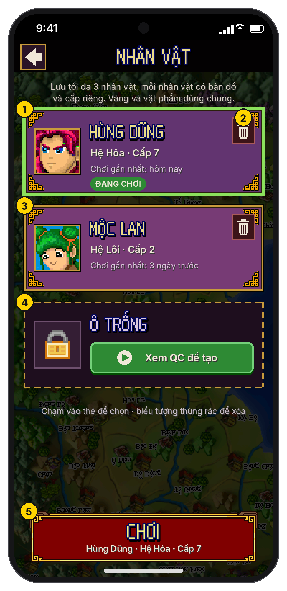

- 3 ô lưu: thẻ nhân vật (tên, hệ, cấp, lần chơi gần nhất, nút xoá) hoặc ô trống. Tạo nhân vật đầu tiên miễn phí, từ nhân vật thứ 2 phải xem quảng cáo; đủ 3 thì phải xoá mới tạo được.
- Chi tiết: [nhiều nhân vật](thiet-ke-nhieu-nhan-vat.md).

**Trước:** chỉ có 1 save.

### 3. Chọn tướng
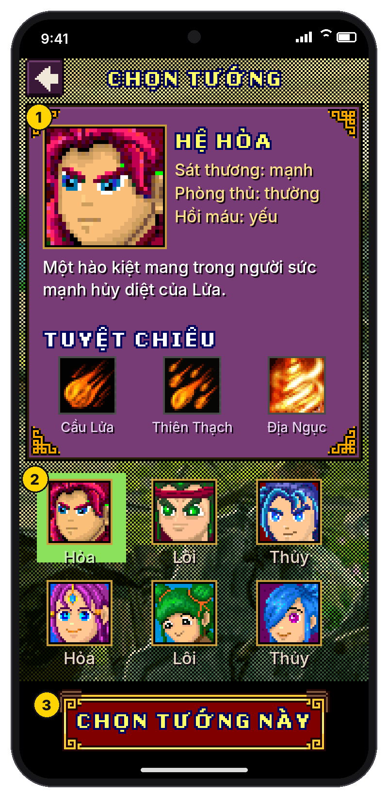

1. **Thẻ lớn của tướng đang chọn:** hệ (Hỏa, Lôi, Thủy), mô tả gốc trong game, 3 tuyệt chiêu.
   - Các dòng "Sát thương / Phòng thủ / Hồi máu" chỉ là chữ giữ chỗ. Cần lấy số thật từ dữ liệu game.
2. **Lưới 6 tướng:** chạm để xem, ô xanh là tướng đang chọn.
3. **Nút xác nhận lớn** ở đáy.

Khi tạo nhân vật thứ 2, 3: tiêu đề đổi thành "TẠO NHÂN VẬT · Ô n", tướng đã có ở ô khác có nhãn "Ô x" ([chi tiết](thiet-ke-nhieu-nhan-vat.md#45-tạo-nhân-vật-nhập-tên--chọn-tướng)).

**Trước:** 6 chân dung nhỏ cùng một dòng mô tả; chọn bằng phím mềm "Chọn" / "Trở về".

### 4. Hội thoại cốt truyện
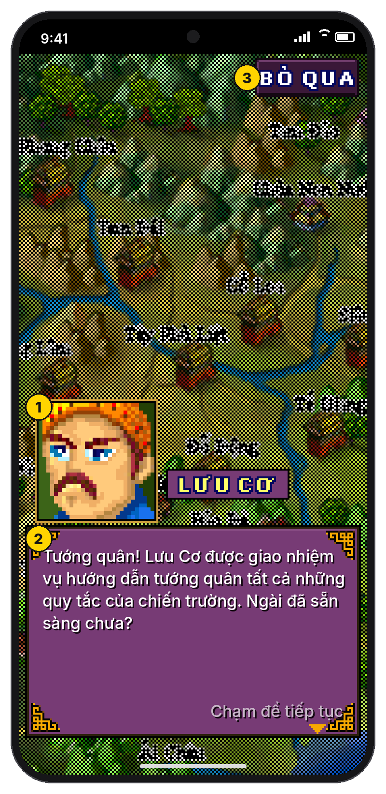

1. **Chân dung lớn** và bảng tên người nói.
2. **Khung chữ to ở nửa dưới**, chạm bất kỳ đâu để sang câu tiếp.
3. Nút **"Bỏ qua"** ở góc trên.

Màn này cũng dùng ở chế độ **chỉ đọc** khi xem lại hội thoại từ thẻ Nhiệm vụ.

**Trước:** bong bóng chữ nhỏ cạnh chân dung 30x30.

### 5. Bản đồ
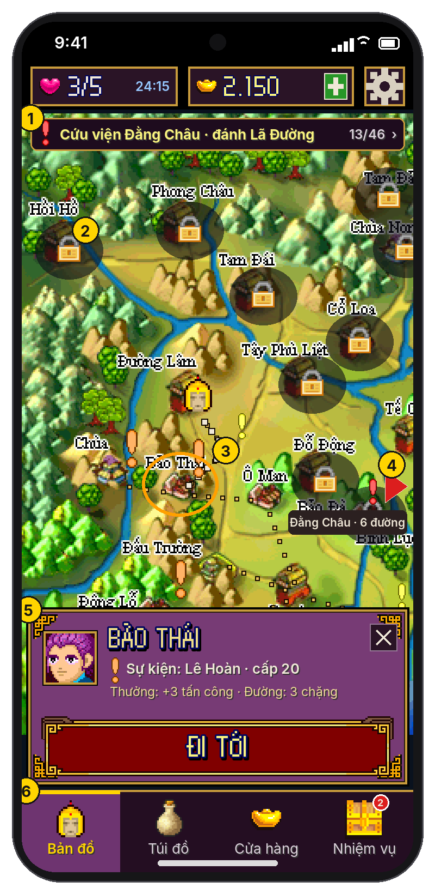

- Bản đồ gốc phóng theo số nguyên, kéo để cuộn. Thành chưa mở có khoá; dấu đỏ / cam / vàng cho nhiệm vụ chính, sự kiện, quân canh.
- Thanh theo dõi nhiệm vụ ở trên, mũi tên chỉ về nhiệm vụ khi nằm ngoài màn.
- Chạm thành: khung thông tin trượt từ dưới lên, nút **ĐI TỚI**; tướng tự đi đường ngắn nhất, tới nơi thì hội thoại / trận đánh tự mở như bản gốc.
- Chi tiết: [giao diện bản đồ, mục 3](thiet-ke-ban-do.md#3-thẻ-bản-đồ).

**Trước:** đi từng ô bằng phím mũi tên; phím mềm "C.Hàng / T.Tin / Thoát"; số mạng ghi nhỏ ở góc.

### 6. Túi đồ
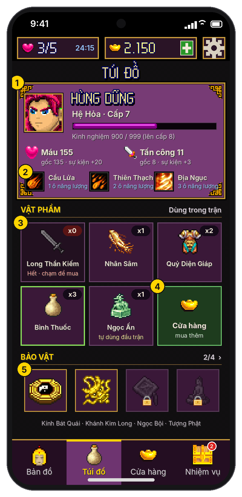

- Thẻ tướng (cấp, kinh nghiệm, máu, tấn công, 3 tuyệt chiêu), 5 vật phẩm, 4 bảo vật. Chạm vật phẩm: hộp chi tiết giữa màn, mua thêm ngay.
- Chi tiết: [giao diện bản đồ, mục 4](thiet-ke-ban-do.md#4-thẻ-túi-đồ).

**Trước:** màn "T.Tin" chỉ có bảng chữ.

### 7. Cửa hàng
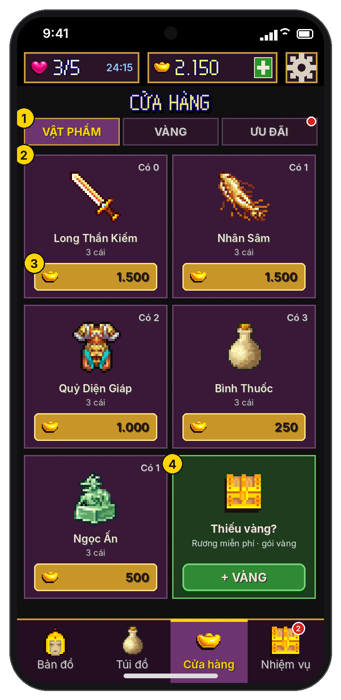 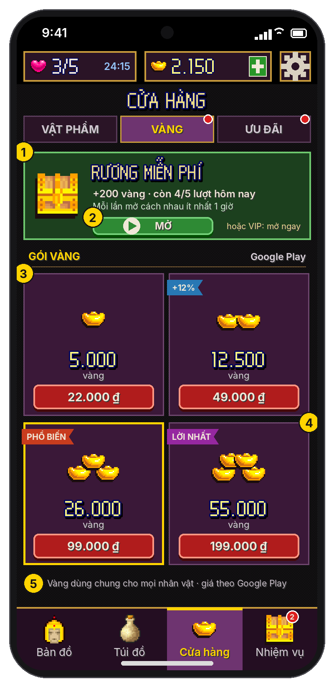 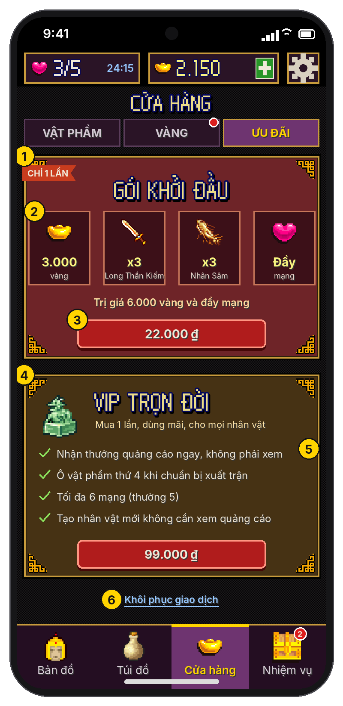

- **Vật phẩm**: thẻ lớn 2 cột, hộp Mua chọn số gói. **Vàng**: rương miễn phí (quảng cáo), 4 gói vàng. **Ưu đãi**: gói khởi đầu, VIP, khôi phục giao dịch.
- Mở từ thẻ Cửa hàng trong game hoặc nút + vàng ở bất kỳ màn nào.
- Chi tiết: [giao diện bản đồ, mục 5](thiet-ke-ban-do.md#5-thẻ-cửa-hàng).

**Trước:** lưới 6 ô nhỏ; chọn bằng phím; mua qua hộp "Có / Không" và SMS.

### 8. Nhiệm vụ
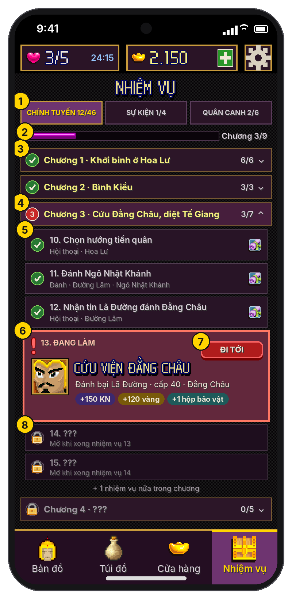

- 3 tab theo dữ liệu game: **Chính tuyến** (46 nhiệm vụ chia 9 chương), **Sự kiện** (8, kèm Đấu trường), **Quân canh** (14). Nhiệm vụ đang làm có nút Đi tới; nhiệm vụ đã xong đọc lại được hội thoại.
- Chi tiết: [giao diện bản đồ, mục 6](thiet-ke-ban-do.md#6-thẻ-nhiệm-vụ).

**Trước:** không có danh sách; chỉ có dấu "!" trên bản đồ.

### 9. Chuẩn bị xuất trận
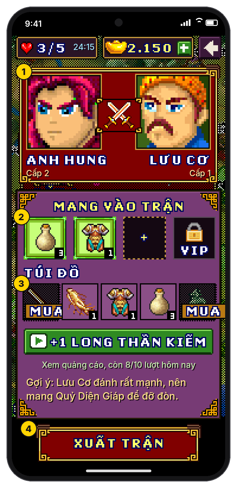

1. **Hai bên đối đầu** với chân dung lớn.
2. **3 ô vật phẩm mang vào trận**, ô thứ 4 dành cho VIP (xem [kế hoạch kiếm tiền](README.md)).
3. **Túi đồ** có nút mua nhanh; dưới túi là nút xem quảng cáo nhận vật phẩm và dòng gợi ý theo đối thủ.
4. **"Xuất trận"** là nút lớn ở đáy.

**Trước:** hộp đối đầu nhỏ đè lên bản đồ, phím mềm "Đánh / Rút lui".

### 10. Trận đấu

Thay đổi so với bản trước:
- tướng địch ở **bên phải**;
- thanh máu, thời gian và năng lượng **giữ đúng như game gốc**;
- có **chữ mô tả hiệu ứng**;
- chạm 1 lần vào chiêu hoặc vật phẩm thì hiện **popup**;
- nhân vật **nói bằng bong bóng chat**.

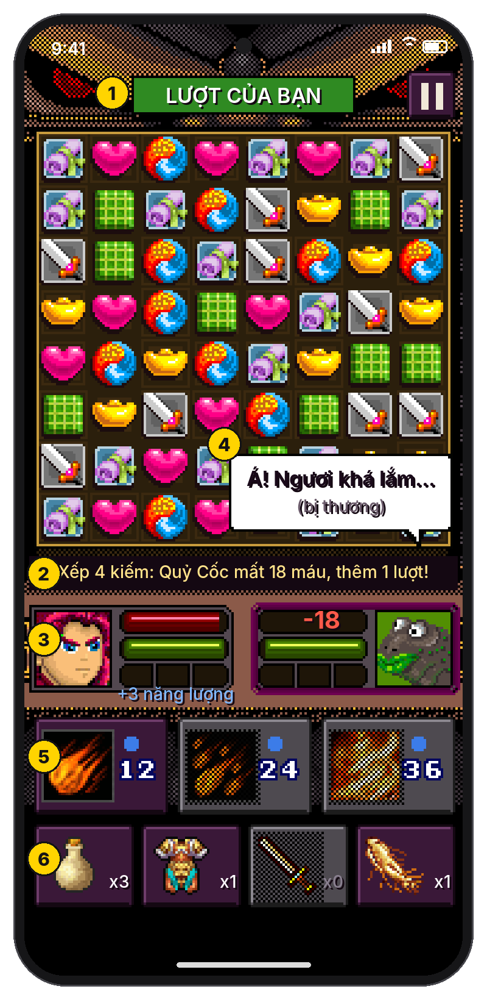

1. **Dòng trên cùng:** báo lượt ("Lượt của bạn" màu xanh / "Lượt đối thủ" màu đỏ) và nút tạm dừng.
2. **Dòng hiệu ứng** ngay dưới bàn cờ, mô tả việc vừa xảy ra. Ví dụ:
   - "Xếp 4 kiếm: Quỷ Cốc mất 18 máu, thêm 1 lượt!";
   - "Quỷ Diện Giáp chặn 3/4".
3. **Hai khung tướng giữ nguyên bản gốc:** người chơi bên trái, tướng địch bên phải, mỗi bên có 3 thanh như game cũ:
   - đỏ: máu;
   - xanh lá: thời gian (lương thực, cạn là thua);
   - 3 ô: năng lượng.

   **Số bay lên** ngay tại thanh tương ứng: "-18" màu đỏ khi bị đánh, "+3 năng lượng" màu xanh dương, "+11 máu" màu xanh lá khi hồi máu.
4. **Bong bóng chat** của nhân vật (xem quy tắc bên dưới).
5. **Hàng tuyệt chiêu:** biểu tượng và số năng lượng cần. Chiêu chưa đủ năng lượng thì mờ.
6. **Hàng vật phẩm:** biểu tượng và số lượng còn lại.

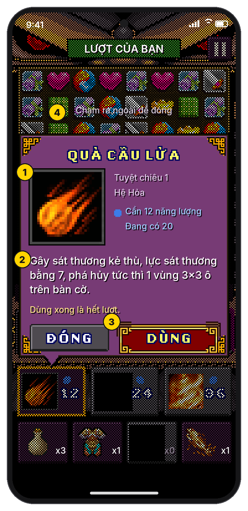

**10b. Chạm 1 lần vào chiêu** thì hiện popup ngay trên nút đó, có mũi nhọn chỉ vào nút.
1. Tên, biểu tượng lớn, hệ, năng lượng cần và năng lượng đang có.
2. Mô tả lấy từ game, có điền sẵn sát thương thật (ví dụ "lực sát thương bằng 7").
3. Nút **DÙNG** và **ĐÓNG**. Nếu chưa đủ năng lượng thì "Dùng" mờ đi, kèm dòng "Cần thêm … năng lượng".
4. **Chạm ra ngoài** popup để đóng.

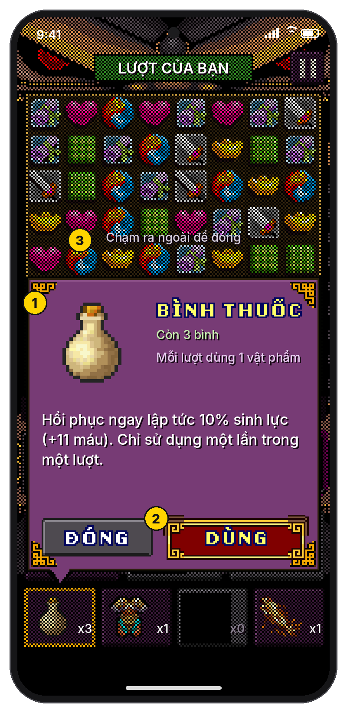

**10c. Chạm 1 lần vào vật phẩm**, hoạt động giống popup chiêu.
1. Tên, hình, số còn lại, giới hạn ("Mỗi lượt dùng 1 vật phẩm"). Mô tả có số cụ thể, ví dụ "+11 máu".
2. Nút **DÙNG** và **ĐÓNG**.
3. Chạm ra ngoài để đóng.

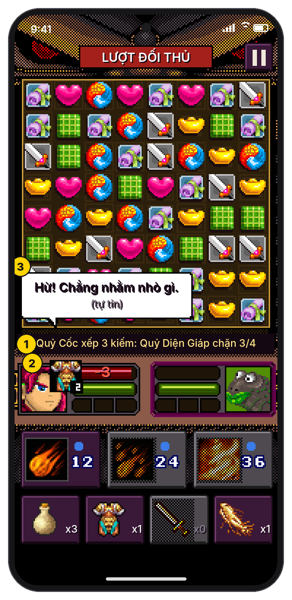

**10d. Lượt đối thủ**
1. Dòng hiệu ứng mô tả đòn của địch và vật phẩm đã chặn đòn.
2. **Biểu tượng hiệu ứng đang có** trên chân dung, kèm số lượt còn lại. Ví dụ: khiên Quỷ Diện Giáp còn 2 lượt.
3. Tướng của người chơi nói một câu thể hiện cảm xúc.

**Quy tắc bong bóng chat:**

| Khi nào | Ai nói | Ví dụ |
|---|---|---|
| Đầu trận | Tướng địch, rồi người chơi | Lấy câu thoại theo nhiệm vụ có sẵn trong game, ví dụ "Nguyễn Siêu, chạy đâu cho thoát. Nạp mạng !!" |
| Bị đánh mạnh (mất từ 15% máu trở lên một lần) | Bên bị đánh | "Á! Ngươi khá lắm..." |
| Chặn được đòn, hồi máu, dùng tuyệt chiêu | Bên vừa làm | "Hừ! Chẳng nhằm nhò gì." / "Nếm thử Quả Cầu Lửa!" |
| Máu dưới 20% | Bên sắp thua | "Không lẽ ta thua ở đây sao..." |
| Thắng / thua | Cả hai | Câu kết lấy từ thoại nhiệm vụ của game, nếu có |

- Mỗi bong bóng hiện khoảng 2 giây, chạm vào thì tắt ngay. Mỗi lúc chỉ hiện một bong bóng.
- Bong bóng **không che** nút bấm và **không chặn** thao tác trên bàn cờ.
- Câu thoại cảm xúc là phần viết thêm. Cần một bảng câu cho từng loại tướng (hảo hán, sơn tặc, yêu quái…).

**Trước:**
- bàn cờ chỉ chiếm khoảng 70% chiều ngang, phần còn lại là khung trang trí;
- tuyệt chiêu và túi đồ phải mở qua phím mềm và một hộp chọn riêng;
- không có chữ mô tả hiệu ứng.

### 11. Kết quả trận
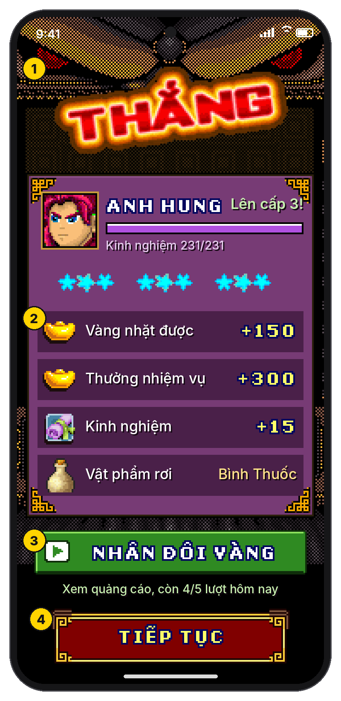

1. **Chữ "THẮNG" lớn**, thanh kinh nghiệm và thông báo lên cấp.
   - Ba ngôi sao đánh giá (ví dụ theo lượng máu còn lại) là **ý tưởng thêm**; game gốc không có.
2. **Danh sách phần thưởng:** vàng, thưởng nhiệm vụ, kinh nghiệm, vật phẩm rơi.
3. **Nhân đôi vàng** bằng quảng cáo (xem kế hoạch kiếm tiền).
4. **"Tiếp tục"** là nút lớn ở đáy.

**Trước:** bảng số liệu đè lên màn trận đấu, phím mềm "Đóng".

### 12. Cài đặt
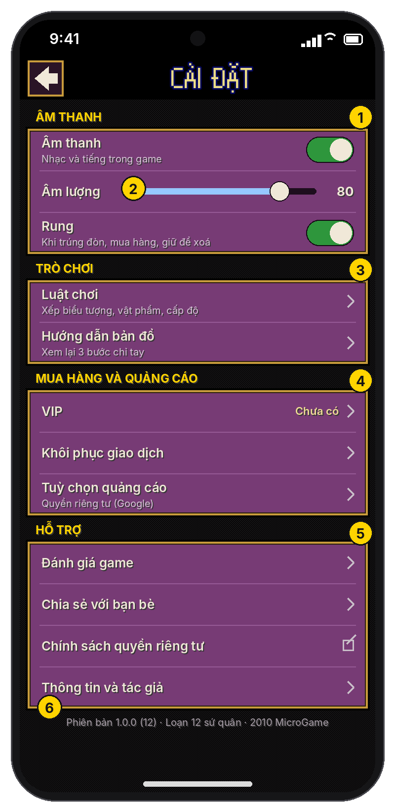

- Âm thanh (bật/tắt, âm lượng, rung), Trò chơi (luật chơi, hướng dẫn bản đồ), Mua hàng và quảng cáo, Hỗ trợ (đánh giá, chia sẻ, quyền riêng tư, thông tin).
- Trên bản đồ thay cho hộp Tạm dừng: thêm "Đổi nhân vật", "Về menu chính", "TIẾP TỤC". Trong trận chỉ có nhóm Âm thanh.
- Chi tiết: [Menu và Cài đặt](thiet-ke-cai-dat.md#2-màn-cài-đặt).

**Trước:** màn âm thanh lúc mở game và các mục chữ trong Menu.

## Luồng màn hình

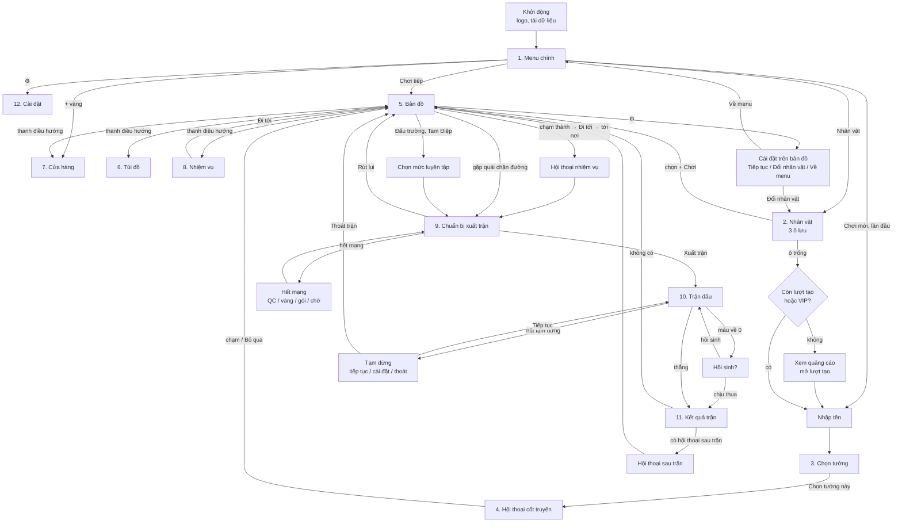

## Màn hình khác tỉ lệ

| Loại máy | Chiều cao lưới ảo (rộng 180) | Cách xử lý |
|---|---|---|
| Điện thoại dài (19.5:9, 20:9) | 390–400 | Bố cục như ảnh nháp |
| Điện thoại 16:9 | 320 | Gộp hàng tuyệt chiêu và hàng vật phẩm thành **một hàng 6 nút**. Bản đồ và các thẻ thấp hơn. |
| Máy tính bảng (4:3) | 240 | Đổi sang **bố cục hai cột**: bàn cờ bên trái, thông tin và nút bên phải. Màn chung dùng khung giữa có viền. |

## Hướng triển khai

Game gốc tự vẽ mọi thứ lên khung 240x320, và phần lớn code vẽ dùng cứng kích thước này. Đã chọn **hướng B: lớp giao diện mới bằng Unity**, giữ phần logic đã chuyển đổi (luật trận đấu, AI, nhiệm vụ, lưu game) và vẽ lại các màn bằng hình gốc.

- Unity đọc trạng thái game và gửi thao tác qua lớp cầu nối **`PortUi`** (Java, dịch sang C# như phần còn lại). Thao tác được xếp hàng và chạy ở đầu khung hình tiếp theo của game.
- Quảng cáo và mua hàng nằm hẳn phía Unity (`Host.showRewarded`, `Host.purchase`…), không qua game.

| Bước | Màn | Trạng thái |
|---|---|---|
| 1 | Chuẩn bị xuất trận, Trận đấu, Kết quả | Đã có trên `ui-touch` |
| 2 | Bản đồ và thanh điều hướng, Túi đồ, Cửa hàng, Nhiệm vụ | Đã có trên `ui-touch` (cầu nối `PortMap`) |
| 3 | Menu, Nhân vật, Chọn tướng, Cài đặt | Đã có trên `ui-touch` (cầu nối `PortScreens`, lưu theo ô); Nhập tên vẫn là hộp chữ của game |
| 4 | Hội thoại cốt truyện, Luật chơi, Thông tin, Sưu tập | Màn ít dùng; tạm giữ màn cũ vừa chiều ngang cho tới khi làm |

**Phông chữ (đã chọn):**
- Tiêu đề, nút, con số lớn: **phông pixel của chính game** (vàng hoặc trắng, có viền tối). Phông này chỉ có chữ in hoa.
- Chữ nhỏ (mô tả, nhãn, bong bóng thoại, dòng hiệu ứng): **Inter** (chữ HD như ảnh nháp), Medium cho chữ thường, Bold cho chữ đậm; cỡ chữ theo `u` ghi trong tài liệu (ví dụ 6.5 u), bóng tối nhẹ phía dưới cho chữ sáng.
  - Inter của Rasmus Andersson, giấy phép SIL OFL 1.1, đủ dấu tiếng Việt (`Resources/Loan12Fonts/Inter-*.ttf`).
  - Trước đó dùng Galmuri9 làm đậm (font pixel); đã đổi sang Inter theo yêu cầu.
- Đã so sánh với Inter, Galmuri11, Galmuri7, Fairfax Bold, VT323 và Tiny5 trên cùng một đoạn chữ, rộng bằng popup: [ảnh so sánh](ui/font-so-sanh.png).
- Các phông pixel khác trên Google Fonts (Pixelify Sans, Press Start 2P, Silkscreen, Jersey…) thiếu dấu tiếng Việt.

**Kiểm tra trên nhiều máy:** Device Simulator của Unity (16:9, 19.5:9, 20:9, máy tính bảng) và ít nhất một máy Android thật.

## Tài liệu và ảnh cũ

- Các màn nháp trong [`mockups/`](mockups/) của [kế hoạch kiếm tiền](README.md) vẽ trên bố cục cũ (khung 3:4). Ý tưởng đã được đặt vào bố cục mới: Chuẩn bị xuất trận, Kết quả, Cửa hàng (Vàng, Ưu đãi), Cài đặt (VIP, khôi phục giao dịch).
- Các ảnh `ui/01_menu.png`, `ui/03_ban-do.png`, `ui/08_cua-hang.png`, `ui/screen-flow.png` của bản đầu đã bỏ; thay bằng ảnh trong `ui/nhan-vat/`, `ui/ban-do/`, `ui/cai-dat/` và sơ đồ luồng ở trên.
