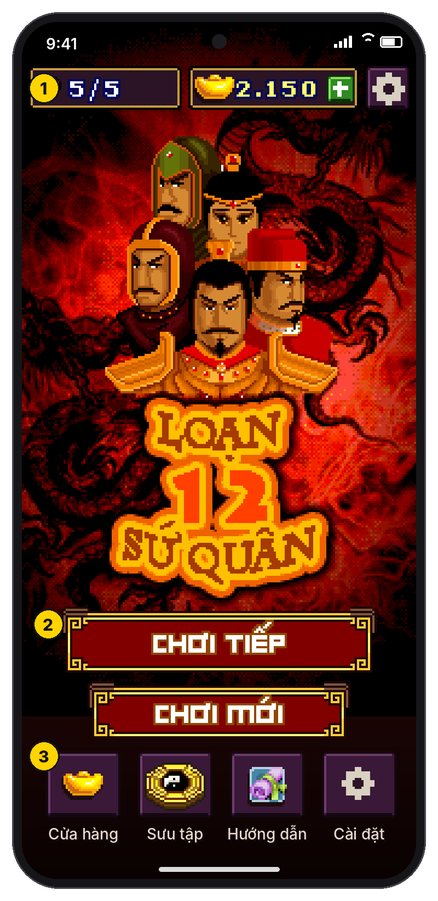
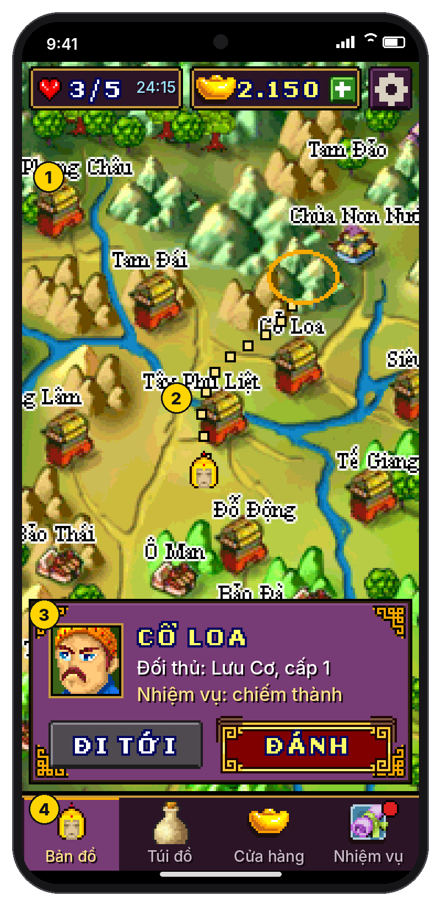
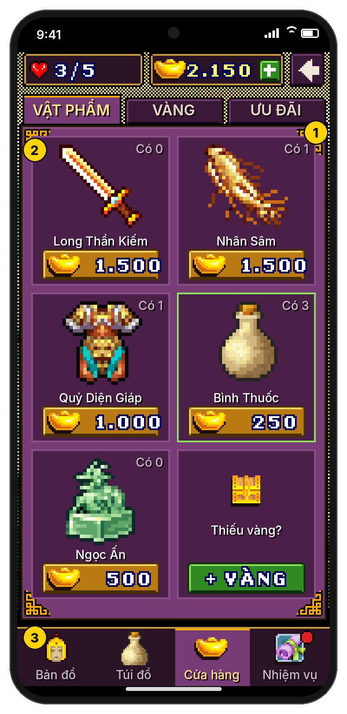
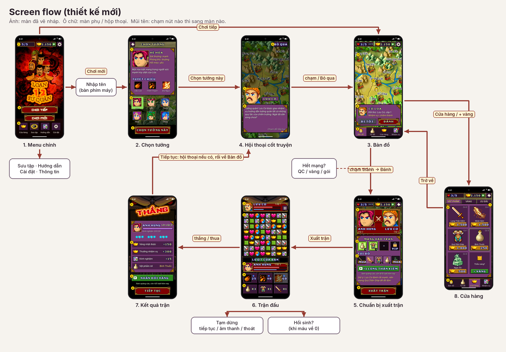
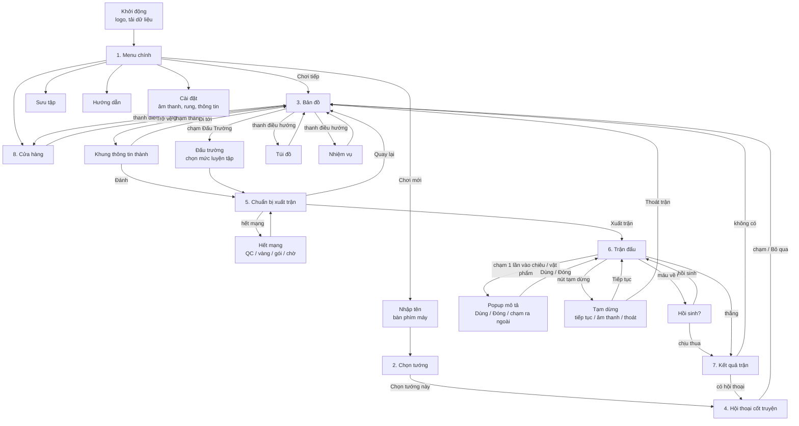

# Thiết kế lại giao diện cho điện thoại cảm ứng (toàn màn hình)

> **Trạng thái:** thiết kế nháp, **chưa code**.
>
> - Ảnh trong [`ui/`](ui/) vẽ bằng chính hình nhân vật, bàn cờ, bản đồ, khung và phông chữ pixel của game.
> - Chữ nhỏ trong ảnh nháp dùng phông HD (Inter). Bản cài đặt (nhánh `ui-touch`) đã đổi sang phông pixel Galmuri9 làm đậm, xem mục "Phông chữ" bên dưới.

## Mục tiêu

- **Dùng hết màn hình dọc.** Không còn khung 240x320 tỉ lệ 3:4 với hai dải đen trên và dưới.
- **Chơi hoàn toàn bằng chạm.** Không cần phím mềm hay bàn phím ảo.
- **Nút lớn, nằm trong tầm ngón cái.** Hành động chính luôn ở nửa dưới màn hình.
- **Giữ chất game gốc.** Nhân vật, bàn cờ, bản đồ và khung viền vẫn là đồ họa pixel gốc.
- **Chữ dễ đọc.** Tiêu đề và nút dùng phông pixel của game; mô tả và chữ nhỏ dùng phông HD có đủ dấu tiếng Việt.

## Nguyên tắc bố cục

1. **Lưới 180 điểm ảo theo chiều ngang**, phóng to theo số nguyên để pixel luôn sắc nét:
   - x4 trên màn rộng 720 px;
   - x6 trên màn rộng 1080 px;
   - x8 trên màn rộng 1440 px.

   Chiều cao co giãn theo từng máy. Phần dư được dồn cho nội dung ở giữa (bản đồ cao hơn, khoảng cách rộng hơn), không chừa dải đen.
2. **Ba vùng cố định:**

   | Vùng | Nội dung |
   |---|---|
   | Trên | Thanh tài nguyên (mạng, vàng) và nút hệ thống (cài đặt, tạm dừng, quay lại) |
   | Giữa | Nội dung chính: bản đồ, bàn cờ, thẻ thông tin |
   | Dưới | Hành động chính và thanh điều hướng |

3. **Hành động chính luôn là nút đỏ khung vàng lớn nhất màn**, ở đáy màn hình. Ví dụ: "Chơi tiếp", "Chọn tướng này", "Đánh", "Xuất trận", "Tiếp tục".
4. **Hộp thoại thành khung trượt từ dưới lên**, cùng kiểu khung tím viền vàng của game. Chạm ra ngoài để đóng.
5. **Kích thước chạm tối thiểu khoảng 48dp** (24 điểm ảo). Nút chính cao 30–40 điểm ảo.
6. **Màu nút thống nhất với [kế hoạch kiếm tiền](README.md):**
   - đỏ khung vàng: hành động chính;
   - xanh lá có biểu tượng ▶: miễn phí, xem quảng cáo;
   - vàng: trả bằng vàng trong game;
   - xám: lựa chọn phụ.
7. **Quay lại** bằng nút góc trên hoặc nút Back của Android. Màn đầu tiên (Menu) hỏi trước khi thoát game.
8. **Tránh vùng "tai thỏ".** Vùng an toàn (safe area) của từng máy được chừa trống.

## Các màn hình

Số trong vòng tròn vàng trên ảnh ứng với các ghi chú bên dưới mỗi ảnh. Dòng "Trước" mô tả bản hiện tại.

### 1. Menu chính

> Nút "Chơi mới" được thay bằng tính năng nhiều nhân vật (tối đa 3 ô): xem [thiết kế nhiều nhân vật](thiet-ke-nhieu-nhan-vat.md).

1. Thanh trên: mạng, vàng, nút Cài đặt.
2. **"Chơi tiếp" là nút lớn nhất**, "Chơi mới" ngay dưới.
3. Bốn lối tắt: Cửa hàng, Sưu tập, Hướng dẫn, Cài đặt.
   - "Thông tin" và "Tác giả" chuyển vào Cài đặt.
   - "Chat OLA", "Game khác" và "Tặng game" (SMS) bỏ đi, hoặc đổi thành "Chia sẻ".

**Trước:** danh sách chữ chọn bằng phím lên/xuống. Trước menu còn một màn hỏi bật/tắt âm thanh; thiết kế mới bỏ màn này (âm thanh mặc định bật, chỉnh trong Cài đặt).

### 2. Chọn tướng

1. **Thẻ lớn của tướng đang chọn:** hệ (Hỏa, Lôi, Thủy), mô tả gốc trong game, 3 tuyệt chiêu.
   - Các dòng "Sát thương / Phòng thủ / Hồi máu" chỉ là chữ giữ chỗ. Cần lấy số thật từ dữ liệu game.
2. **Lưới 6 tướng:** chạm để xem, ô xanh là tướng đang chọn.
3. **Nút xác nhận lớn** ở đáy.

**Trước:** 6 chân dung nhỏ cùng một dòng mô tả; chọn bằng phím mềm "Chọn" / "Trở về".

### 3. Bản đồ

> Mô tả chi tiết 4 thẻ Bản đồ, Túi đồ, Cửa hàng, Nhiệm vụ: xem [giao diện bản đồ](thiet-ke-ban-do.md).

1. **Bản đồ phủ kín màn hình.** Bản đồ gốc (380x380) lớn hơn màn, nên kéo ngón tay để cuộn.
2. **Chạm vào thành để chọn.** Đường đi hiện bằng chấm vàng, tướng tự đi theo đường. Bản port đã có sẵn tính năng chạm-để-đi; thiết kế này chỉ thay phần hiển thị.
3. **Khung thông tin thành:** đối thủ, nhiệm vụ, nút "Đi tới" và "Đánh".
4. **Thanh điều hướng:** Bản đồ, Túi đồ, Cửa hàng, Nhiệm vụ (chấm đỏ khi có việc mới).

**Trước:** đi từng ô bằng phím mũi tên; phím mềm "C.Hàng / T.Tin / Thoát"; số mạng ghi nhỏ ở góc.

### 4. Hội thoại cốt truyện

1. **Chân dung lớn** và bảng tên người nói.
2. **Khung chữ to ở nửa dưới**, chạm bất kỳ đâu để sang câu tiếp.
3. Nút **"Bỏ qua"** ở góc trên.

**Trước:** bong bóng chữ nhỏ cạnh chân dung 30x30.

### 5. Chuẩn bị xuất trận

1. **Hai bên đối đầu** với chân dung lớn.
2. **3 ô vật phẩm mang vào trận**, ô thứ 4 dành cho VIP (xem [kế hoạch kiếm tiền](README.md)).
3. **Túi đồ** có nút mua nhanh; dưới túi là nút xem quảng cáo nhận vật phẩm và dòng gợi ý theo đối thủ.
4. **"Xuất trận"** là nút lớn ở đáy.

**Trước:** hộp đối đầu nhỏ đè lên bản đồ, phím mềm "Đánh / Rút lui".

### 6. Trận đấu (đã sửa theo góp ý)

Thay đổi so với bản trước:
- tướng địch ở **bên phải**;
- thanh máu, thời gian và năng lượng **giữ đúng như game gốc**;
- có **chữ mô tả hiệu ứng**;
- chạm 1 lần vào chiêu hoặc vật phẩm thì hiện **popup**;
- nhân vật **nói bằng bong bóng chat**.

1. **Dòng trên cùng:** báo lượt ("Lượt của bạn" màu xanh / "Lượt đối thủ" màu đỏ) và nút tạm dừng.
2. **Dòng hiệu ứng** ngay dưới bàn cờ, mô tả việc vừa xảy ra. Ví dụ:
   - "Xếp 4 kiếm: Quỷ Cốc mất 18 máu, thêm 1 lượt!";
   - "Quỷ Diện Giáp chặn 3/4".
3. **Hai khung tướng giữ nguyên bản gốc:** người chơi bên trái, tướng địch bên phải, mỗi bên có 3 thanh như game cũ:
   - đỏ: máu;
   - xanh lá: thời gian (lương thực, cạn là thua);
   - 3 ô: năng lượng.

   **Số bay lên** ngay tại thanh tương ứng: "-18" màu đỏ khi bị đánh, "+3 năng lượng" màu xanh dương, "+11 máu" màu xanh lá khi hồi máu.
4. **Bong bóng chat** của nhân vật (xem quy tắc bên dưới).
5. **Hàng tuyệt chiêu:** biểu tượng và số năng lượng cần. Chiêu chưa đủ năng lượng thì mờ.
6. **Hàng vật phẩm:** biểu tượng và số lượng còn lại.

**6b. Chạm 1 lần vào chiêu** thì hiện popup ngay trên nút đó, có mũi nhọn chỉ vào nút.
1. Tên, biểu tượng lớn, hệ, năng lượng cần và năng lượng đang có.
2. Mô tả lấy từ game, có điền sẵn sát thương thật (ví dụ "lực sát thương bằng 7").
3. Nút **DÙNG** và **ĐÓNG**. Nếu chưa đủ năng lượng thì "Dùng" mờ đi, kèm dòng "Cần thêm … năng lượng".
4. **Chạm ra ngoài** popup để đóng.

**6c. Chạm 1 lần vào vật phẩm**, hoạt động giống popup chiêu.
1. Tên, hình, số còn lại, giới hạn ("Mỗi lượt dùng 1 vật phẩm"). Mô tả có số cụ thể, ví dụ "+11 máu".
2. Nút **DÙNG** và **ĐÓNG**.
3. Chạm ra ngoài để đóng.

**6d. Lượt đối thủ**
1. Dòng hiệu ứng mô tả đòn của địch và vật phẩm đã chặn đòn.
2. **Biểu tượng hiệu ứng đang có** trên chân dung, kèm số lượt còn lại. Ví dụ: khiên Quỷ Diện Giáp còn 2 lượt.
3. Tướng của người chơi nói một câu thể hiện cảm xúc.

**Quy tắc bong bóng chat:**

| Khi nào | Ai nói | Ví dụ |
|---|---|---|
| Đầu trận | Tướng địch, rồi người chơi | Lấy câu thoại theo nhiệm vụ có sẵn trong game, ví dụ "Nguyễn Siêu, chạy đâu cho thoát. Nạp mạng !!" |
| Bị đánh mạnh (mất từ 15% máu trở lên một lần) | Bên bị đánh | "Á! Ngươi khá lắm..." |
| Chặn được đòn, hồi máu, dùng tuyệt chiêu | Bên vừa làm | "Hừ! Chẳng nhằm nhò gì." / "Nếm thử Quả Cầu Lửa!" |
| Máu dưới 20% | Bên sắp thua | "Không lẽ ta thua ở đây sao..." |
| Thắng / thua | Cả hai | Câu kết lấy từ thoại nhiệm vụ của game, nếu có |

- Mỗi bong bóng hiện khoảng 2 giây, chạm vào thì tắt ngay. Mỗi lúc chỉ hiện một bong bóng.
- Bong bóng **không che** nút bấm và **không chặn** thao tác trên bàn cờ.
- Câu thoại cảm xúc là phần viết thêm. Cần một bảng câu cho từng loại tướng (hảo hán, sơn tặc, yêu quái…).

**Trước:**
- bàn cờ chỉ chiếm khoảng 70% chiều ngang, phần còn lại là khung trang trí;
- tuyệt chiêu và túi đồ phải mở qua phím mềm và một hộp chọn riêng;
- không có chữ mô tả hiệu ứng.

### 7. Kết quả trận

1. **Chữ "THẮNG" lớn**, thanh kinh nghiệm và thông báo lên cấp.
   - Ba ngôi sao đánh giá (ví dụ theo lượng máu còn lại) là **ý tưởng thêm**; game gốc không có.
2. **Danh sách phần thưởng:** vàng, thưởng nhiệm vụ, kinh nghiệm, vật phẩm rơi.
3. **Nhân đôi vàng** bằng quảng cáo (xem kế hoạch kiếm tiền).
4. **"Tiếp tục"** là nút lớn ở đáy.

**Trước:** bảng số liệu đè lên màn trận đấu, phím mềm "Đóng".

### 8. Cửa hàng

1. Ba tab: Vật phẩm, Vàng, Ưu đãi.
2. **Thẻ lớn hai cột:** hình to, số đang có, giá ghi ngay trên nút mua. Ô "Thiếu vàng?" dẫn sang tab Vàng.
3. Thanh điều hướng giống Bản đồ.

**Trước:** lưới 6 ô nhỏ; chọn bằng phím; mua qua hộp "Có / Không".

## Screen flow

Sơ đồ đầy đủ, gồm cả các màn phụ chưa vẽ nháp (Túi đồ, Nhiệm vụ, Sưu tập, Cài đặt, Tạm dừng, Đấu trường):

## Màn hình khác tỉ lệ

| Loại máy | Chiều cao lưới ảo (rộng 180) | Cách xử lý |
|---|---|---|
| Điện thoại dài (19.5:9, 20:9) | 390–400 | Bố cục như ảnh nháp |
| Điện thoại 16:9 | 320 | Gộp hàng tuyệt chiêu và hàng vật phẩm thành **một hàng 6 nút**. Bản đồ và các thẻ thấp hơn. |
| Máy tính bảng (4:3) | 240 | Đổi sang **bố cục hai cột**: bàn cờ bên trái, thông tin và nút bên phải. Màn chung dùng khung giữa có viền. |

## Hướng triển khai (để dành khi bắt đầu code)

Game gốc tự vẽ mọi thứ lên khung 240x320, và phần lớn code vẽ dùng cứng kích thước này. Có hai hướng làm:

| Hướng | Cách làm | Ưu | Nhược |
|---|---|---|---|
| A. Bố cục lại bên trong game | Đổi khung ảo thành 180 x (320–400). Sửa code vẽ của từng màn (Java gốc → C#), như cách đang vá hiện nay. | Giữ đúng một luồng code; kiểm thử so sánh Java/C# vẫn dùng được | Phải sửa rất nhiều chỗ dùng cứng 240x320. Chữ vẫn là chữ pixel. Khó thêm hiệu ứng mới. |
| B. Lớp giao diện mới bằng Unity | Giữ phần logic đã chuyển đổi (luật trận đấu, AI, nhiệm vụ, lưu game) và vẽ lại các màn bằng Unity UI với hình gốc | Chữ HD, hiệu ứng, co giãn theo màn hình dễ; cũng là chỗ gắn quảng cáo và mua hàng | Phải tách logic khỏi phần vẽ (code dịch ngược đang trộn lẫn). Khối lượng lớn nhất. |

**Đề xuất:** làm kiểu B **theo từng phần**.

1. Trước tiên làm 4 màn dùng nhiều nhất: **Trận đấu, Bản đồ, Chuẩn bị xuất trận, Kết quả**.
2. Các màn ít dùng (Hướng dẫn, Sưu tập, Thông tin…) tạm giữ màn cũ, hiển thị vừa chiều ngang như bản hiện tại.
3. Lần lượt thay hết các màn còn lại.

**Phông chữ (đã chọn):**
- Tiêu đề, nút, con số lớn: **phông pixel của chính game** (vàng hoặc trắng, có viền tối). Phông này chỉ có chữ in hoa.
- Chữ nhỏ (mô tả, nhãn, bong bóng thoại): **Galmuri9 làm đậm**.
  - Galmuri9 của Lee Minseo, giấy phép SIL OFL 1.1, đủ dấu tiếng Việt, có chữ thường.
  - Được "nướng" sẵn thành ảnh pixel 1-bit, nét dọc dày 2 điểm ảnh như chữ của game.
  - Vẽ cùng tỉ lệ với hình của game, có viền tối 1 điểm ảnh.
- Đã so sánh với Inter, Galmuri11, Galmuri7, Fairfax Bold, VT323 và Tiny5 trên cùng một đoạn chữ, rộng bằng popup: [ảnh so sánh](ui/font-so-sanh.png).
- Các phông pixel khác trên Google Fonts (Pixelify Sans, Press Start 2P, Silkscreen, Jersey…) thiếu dấu tiếng Việt.

**Kiểm tra trên nhiều máy:** Device Simulator của Unity (16:9, 19.5:9, 20:9, máy tính bảng) và ít nhất một máy Android thật.

## Liên quan

- [Giao diện bản đồ](thiet-ke-ban-do.md): chi tiết 4 thẻ Bản đồ, Túi đồ, Cửa hàng, Nhiệm vụ, kèm danh sách 46 nhiệm vụ.
- [Thiết kế nhiều nhân vật](thiet-ke-nhieu-nhan-vat.md): Menu chính với 3 ô nhân vật, tạo thêm nhân vật bằng quảng cáo, vàng và vật phẩm dùng chung.
- Các màn nháp trong [`mockups/`](mockups/) của [kế hoạch kiếm tiền](README.md) được vẽ trên bố cục cũ (khung 3:4). Ý tưởng giữ nguyên, sẽ đặt vào bố cục mới:
  - nút xem quảng cáo;
  - hết mạng;
  - hồi sinh;
  - gói khởi đầu và VIP.
- Hai màn **Chuẩn bị xuất trận** và **Kết quả** ở trên đã gộp sẵn các ý đó.
