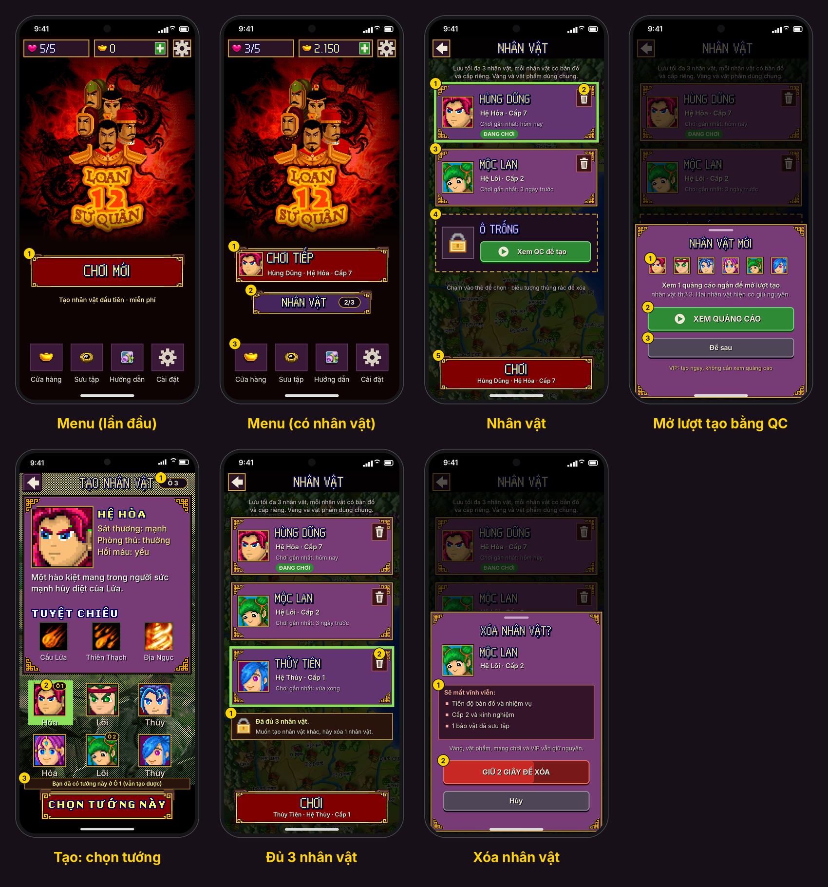
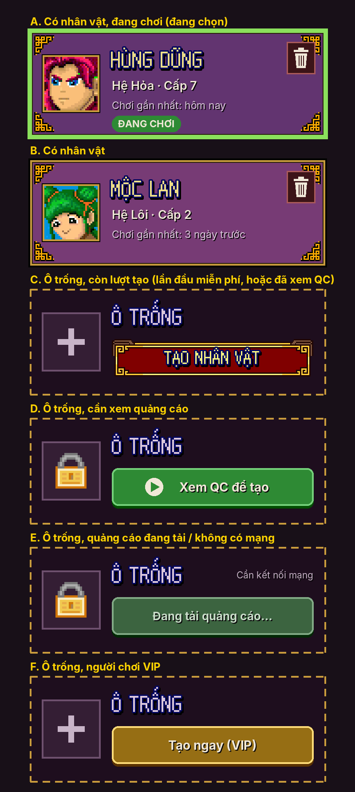
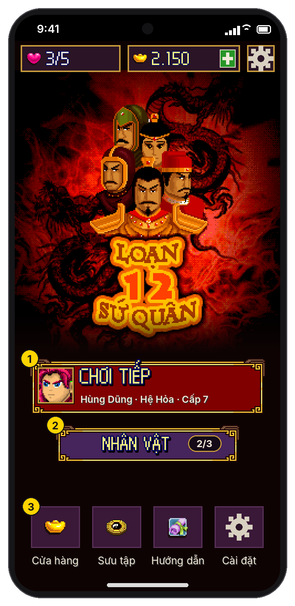
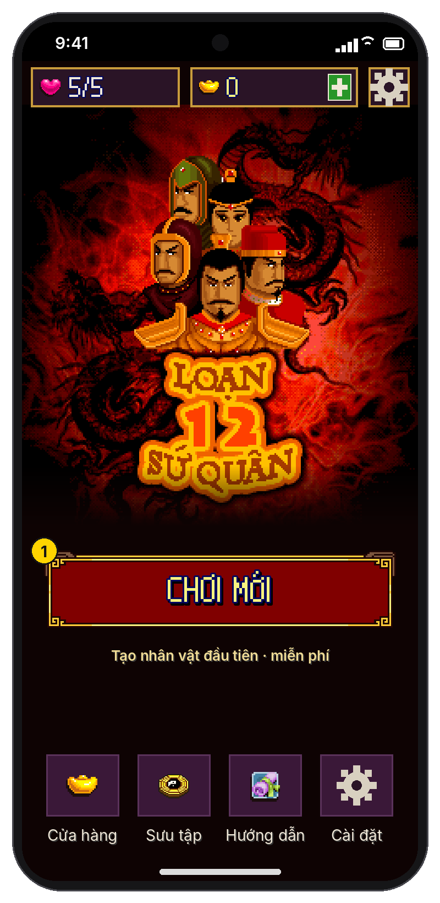
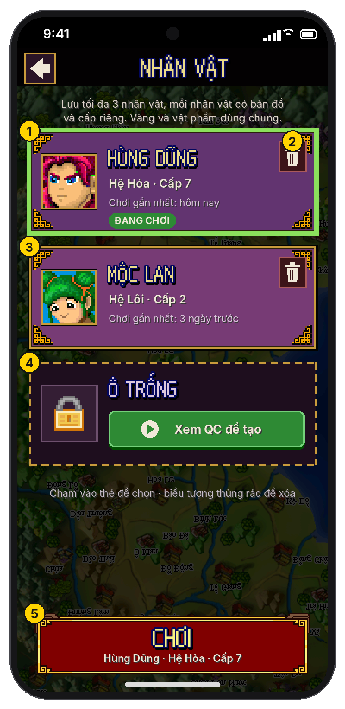
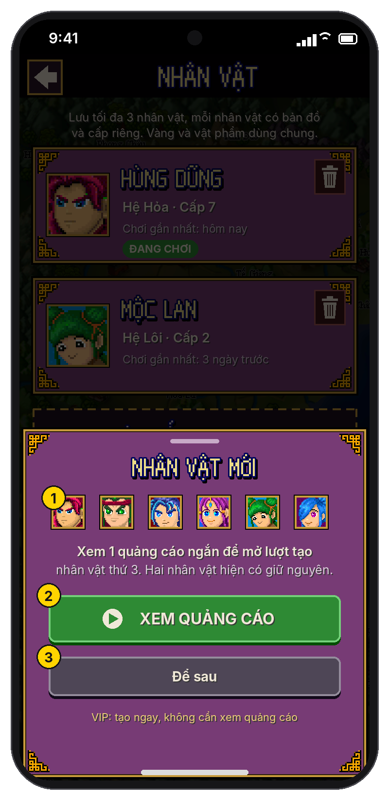
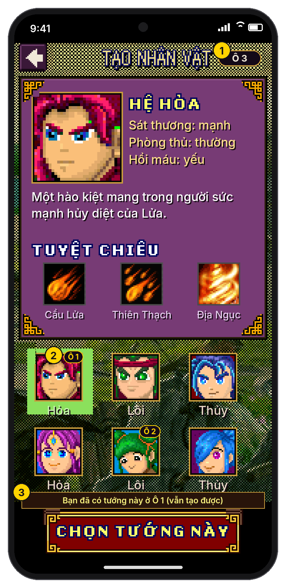
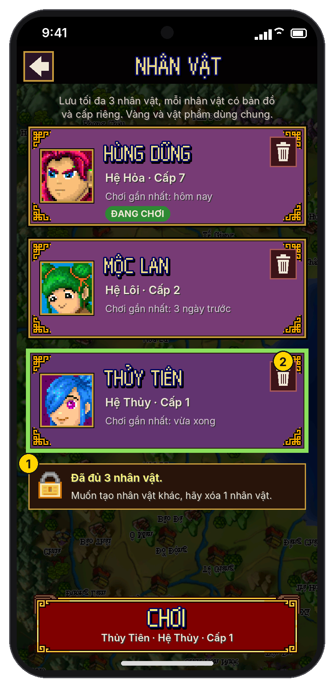
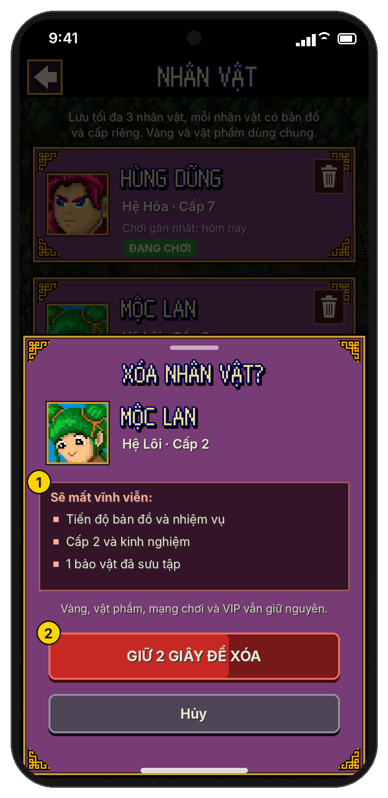
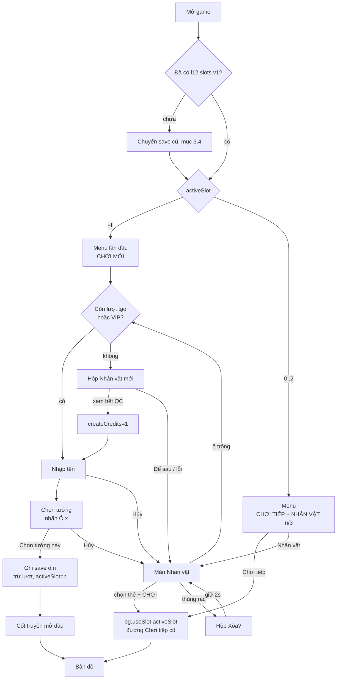

# Nhiều nhân vật (tối đa 3 ô lưu) — Menu chính

> **Trạng thái:** thiết kế để implement, **chưa code**.
>
> - Ảnh nằm trong [`ui/nhan-vat/`](ui/nhan-vat/), vẽ bằng hình gốc của game (`Converter/assets/png`), cùng lưới và màu với [thiết kế giao diện](thiet-ke-giao-dien.md).
> - Toạ độ ghi theo **điểm ảo** (lưới rộng 180, chiều cao co giãn), viết `u`. 1 u = 4 px trên ảnh nháp.
> - Phần mã nguồn nhắc tới là bản Java đã dịch ngược trên nhánh `ui-touch` (`Converter/jsrc`).



## 1. Luật

| # | Luật |
|---|---|
| L1 | Lưu tối đa **3 nhân vật** trên một máy (3 ô cố định: Ô 1, Ô 2, Ô 3). Mỗi nhân vật có tên, tướng (1 trong 6), bản đồ, nhiệm vụ, cấp, kinh nghiệm và bộ sưu tập **riêng**. |
| L2 | Tạo nhân vật mới **không xoá** nhân vật cũ. Bỏ hẳn luật cũ "Chơi mới = xoá save". |
| L3 | **Lần tạo đầu tiên trên máy: miễn phí.** Từ lần tạo thứ 2 trở đi (kể cả tạo lại sau khi xoá) phải **xem 1 quảng cáo thưởng** để được 1 **lượt tạo**. |
| L4 | Lượt tạo đã nhận được **giữ lại** cho tới khi dùng: xem quảng cáo xong mà thoát giữa chừng thì lần sau không phải xem lại. Tối đa giữ **1** lượt (không tích luỹ). |
| L5 | Lượt tạo chỉ bị trừ khi nhân vật **được tạo xong** (bấm "Chọn tướng này"). Thoát ở bước nhập tên / chọn tướng thì không mất lượt. |
| L6 | Đủ 3 nhân vật thì **không tạo thêm được**. Muốn chơi nhân vật khác phải **xoá** một nhân vật. Xoá là vĩnh viễn. |
| L7 | VIP: không phải xem quảng cáo, bấm là tạo (giống các điểm quảng cáo khác trong [kế hoạch kiếm tiền](README.md)). Luật 3 ô vẫn giữ. |
| L8 | Được chọn trùng tướng với nhân vật đã có, nhưng màn chọn tướng **đánh dấu** tướng đã có (mục 4.5). |
| L9 | Dữ liệu **chung cho mọi nhân vật**: **vàng**, **vật phẩm** (túi đồ), **mạng chơi**, đồng hồ hồi mạng, VIP, gói khởi đầu đã mua, số lượt quảng cáo trong ngày, cài đặt âm thanh. Vàng kiếm hay mua ở nhân vật nào cũng dùng được cho nhân vật khác; xoá nhân vật không mất vàng và vật phẩm. Đổi nhân vật không "lách" được giới hạn mạng. |

Định nghĩa dùng trong tài liệu:

- **Ô có nhân vật**: ô đã tạo xong (đã ghi tên và loại tướng).
- **Nhân vật đang chơi** (`activeSlot`): nhân vật mà "Chơi tiếp" sẽ vào. Là nhân vật chơi gần nhất.
- **Lượt tạo** (`createCredits`, 0 hoặc 1): quyền tạo 1 nhân vật. Lần đầu được tặng sẵn 1 lượt.

## 2. Trạng thái của một ô



| Mã | Điều kiện | Hiển thị | Chạm vào |
|---|---|---|---|
| A | Có nhân vật, đang được chọn | Viền xanh lá (139,224,92) dày 1.5 u; nhãn "ĐANG CHƠI" nếu là `activeSlot` | — |
| B | Có nhân vật | Thẻ tím viền vàng | Chọn thẻ đó |
| C | Trống, `createCredits = 1` (lần đầu miễn phí, hoặc đã xem quảng cáo mà chưa dùng) | Viền vàng nét đứt, ô "+", nút đỏ **TẠO NHÂN VẬT** | Vào luồng tạo (mục 5) |
| D | Trống, `createCredits = 0`, không VIP, quảng cáo sẵn sàng | Ô khoá, nút xanh **▶ Xem QC để tạo** | Mở hộp 4.3 |
| E | Như D nhưng quảng cáo chưa tải xong / không có mạng | Nút xanh mờ "Đang tải quảng cáo…"; nếu không có mạng thì thêm dòng phải "Cần kết nối mạng" | Không làm gì; tự chuyển sang D khi quảng cáo sẵn sàng |
| F | Trống, VIP | Nút vàng **Tạo ngay (VIP)** | Vào luồng tạo, không xem quảng cáo |

Chỉ **ô trống đầu tiên** (theo thứ tự Ô 1 → Ô 3) hiện nút tạo. Các ô trống phía sau hiện dạng C/D/E/F nhưng **mờ 50% và không chạm được**, để người chơi luôn lấp ô theo thứ tự. *(Khi tất cả ô trống, ví dụ sau khi xoá hết, chỉ Ô 1 bấm được.)*

## 3. Dữ liệu và lưu trữ

### 3.1 Bản ghi hiện có của game (đọc từ code)

Game gốc lưu vào 2 RecordStore: `"16b"` (`bg.b`) và `"161b"` (`bg.c`). Bản Unity ghi mỗi store thành 1 khoá PlayerPrefs (`UnityBackend`, base64).

| Store / bản ghi | Nội dung | Ai đọc/ghi | Thuộc về |
|---|---|---|---|
| 16b #100 | Save bản đồ: vị trí, thành, nhiệm vụ, máu (`dd.b`), cấp/chỉ số tướng (`dd.e`)… | `aa.v()` / `aa.w()` qua `f.a(byte[])` | **Nhân vật** |
| 16b #101 | Trạng thái hướng dẫn trên bản đồ (`aa.R`) | `dd.a()` | Nhân vật |
| 16b #103 | Kinh nghiệm | `dd.b()` | Nhân vật |
| 16b #104 | Tên người chơi (UTF) | `dd.c()` / `dd.a(String)` | Nhân vật |
| 16b #105 | Loại tướng 0–5 | `dd.d()` / `dd.c(int)`, ghi ở `z.java` khi "Chọn" | Nhân vật |
| 16b #10, #16 | Bị xoá khi chơi mới (`bg.a()`) | — | Nhân vật |
| 16b #4, #5, #6, #7 | Cờ "lần đầu", số mạng, số mạng cho lần chơi mới sau | `bg.j/k/l/m/n/c` | **Chung** (thay bằng hệ thống mạng hồi theo giờ) |
| 16b #8 | Bộ đếm `cx.G` (dùng cho SMS "reco") | `bg.i()` | Chung |
| 16b #11 | Âm lượng | `bg.o()/d()` | Chung |
| 16b #12 | Cờ đã nhận quà bộ sưu tập | `bg.q()/r()` | Nhân vật |
| 16b #13 | Cờ thiết bị phát được âm thanh | `bg.p()/a(bool)` | Chung |
| 16b #14 | Mã kiểm tra SMS | `al` | Chung (sẽ bỏ cùng SMS) |
| 161b #1, #2, #3 | Bảo vật sưu tập, mã trúng thưởng | `bg.s/t/u/w/x` | Nhân vật (game gốc xoá khi chơi mới) |
| 161b #9 | **Ví và túi đồ**: mảng 6 số nguyên. Chỉ số 2 là **vàng** (Cửa hàng trừ bằng `bg.b(2, giá)` ở `q.java`; Đấu trường ở `co.java`; nhặt vàng trong trận `bg.a(2, i, 6)` ở `dd.java`). Các chỉ số còn lại là số lượng vật phẩm. | `bg.a(i,n,6)`, `bg.v/f/b/g` | **Chung** |
| 161b #106 | Save giữa trận (để "Chơi tiếp" vào thẳng trận) | `f.a(byte[],…)`/`f.d()`/`f.e()` | Nhân vật |

> Vàng và vật phẩm nằm chung một bản ghi (161b #9), nên chỉ cần chuyển **đúng bản ghi này** sang store chung là cả vàng lẫn vật phẩm dùng chung (quyết định Q2). Gói vàng mua bằng tiền thật cộng vào ví chung.
>
> `dd.e.g` trong save bản đồ (#100) là chỉ số của tướng, không phải ví; không đụng tới.

### 3.2 Cách tách theo ô

- Store theo nhân vật đổi tên theo ô: `"16b"` → `"s{n}_16b"`, `"161b"` → `"s{n}_161b"` với `n` = 0, 1, 2.
- Bản ghi chung chuyển sang 2 store riêng, sửa ngay trong các hàm `bg.*` (không cần đụng code nơi khác):
  - 16b #4–#8, #11, #13, #14 → `"acct_16b"` (biến `bg.acct`): đổi `bg.b` thành `bg.acct` trong `bg.i/j/k/l/m/n/c/o/d/p/a(bool)/g/h/b(byte[])`;
  - 161b #9 (vàng + vật phẩm) → `"acct_161b"` (biến `bg.acctC`): đổi `bg.c` thành `bg.acctC` trong `bg.a(int,int,int)`, `bg.v()`, `bg.f(int)`, `bg.b(int,int)`, `bg.g(int)`.
  - Xoá phần `dr.c(c, 9)` trong `bg.a()` (hàm xoá save khi chơi mới), để tạo nhân vật mới **không** xoá ví.
- `bg.b` và `bg.c` hiện là `static` gán một lần. Đổi thành gán lại được qua hàm mới `bg.useSlot(int n)`:
  1. ghi (`dr.a(...)`) store hiện tại nếu còn thay đổi;
  2. `bg.b = dr.a("s"+n+"_16b", 16)`, `bg.c = dr.a("s"+n+"_161b", 161)`;
  3. đặt lại trạng thái trong bộ nhớ của nhân vật cũ: `dd.e = null`, `dd.b = 0`, `cx.G` giữ nguyên (chung).
- Sau `useSlot(n)` luôn đi theo **đúng đường "Chơi tiếp" lúc mở game** (`ac`, mục chọn 0): nếu `f.e()` (có save giữa trận) thì vào trận, không thì vào bản đồ. Không viết đường nạp riêng.

### 3.3 Dữ liệu mới (PlayerPrefs, khoá `l12.slots.v1`, JSON)

```json
{
  "version": 1,
  "activeSlot": 0,
  "createCredits": 0,
  "everCreated": 2,
  "slots": [
    { "used": true,  "hero": 0, "name": "HÙNG DŨNG", "level": 7, "createdAt": 1762100000, "lastPlayedAt": 1762180000 },
    { "used": true,  "hero": 4, "name": "MỘC LAN",   "level": 2, "createdAt": 1762120000, "lastPlayedAt": 1761900000 },
    { "used": false }
  ]
}
```

| Trường | Ý nghĩa |
|---|---|
| `activeSlot` | -1 nếu chưa có nhân vật nào |
| `createCredits` | 0 hoặc 1. Cài mới: **1** (lượt miễn phí). |
| `everCreated` | Tổng số lần đã tạo xong trên máy. Chỉ để thống kê; luật dùng `createCredits`. |
| `slots[i]` | **Bản tóm tắt** để vẽ menu mà không phải nạp save. Cập nhật mỗi lần game ghi #100 (trong `f.a(byte[])`): `level = dd.e.e`, `lastPlayedAt = now`. `name`, `hero` ghi lúc tạo. |

Thứ tự ghi khi tạo xong (để tắt máy giữa chừng không hỏng): ghi save của ô → ghi `slots[n].used=true` → trừ `createCredits` → `activeSlot = n` → `PlayerPrefs.Save()`.

Thứ tự khi xoá: `slots[n].used=false` + `PlayerPrefs.Save()` → xoá 2 store `s{n}_*` → nếu `n == activeSlot` thì `activeSlot` = ô có `lastPlayedAt` lớn nhất còn lại, hoặc -1. Lúc mở game, ô nào `used=false` mà vẫn còn store `s{n}_*` thì xoá store đó (dọn rác).

### 3.4 Chuyển save cũ (người đã chơi bản trước)

Chạy một lần khi chưa có `l12.slots.v1`:

1. Nếu có store `"16b"` hoặc `"161b"`:
   - chép các bản ghi chung (mục 3.1) sang `acct_16b`, và 161b #9 (vàng + vật phẩm) sang `acct_161b`;
   - đổi tên `"16b"` → `"s0_16b"`, `"161b"` → `"s0_161b"`;
   - nếu `s0_16b` có #104 **hoặc** #100 thì `slots[0] = {used: true, hero: #105, name: #104, level: lấy từ #100 nếu đọc được, không thì 1}`, `activeSlot = 0`, `createCredits = 0`, `everCreated = 1` (lượt miễn phí coi như đã dùng);
   - nếu không thì coi như cài mới.
2. Không có gì: `activeSlot = -1`, `createCredits = 1`, `everCreated = 0`.

## 4. Màn hình

### 4.1 Menu chính — có nhân vật



Thay cho cặp nút "Chơi tiếp / Chơi mới" ở [Menu chính](thiet-ke-giao-dien.md#1-menu-chính).

1. **Nút "CHƠI TIẾP"** (đỏ khung vàng, rộng 160 u, cao 37 u, cách lề 10 u):
   - chân dung tướng của `activeSlot` 30×30 phóng x3 (22.5 u), viền vàng, cách mép trái 6 u;
   - dòng 1 phông pixel: "CHƠI TIẾP";
   - dòng 2 phông HD 6.5 u: `{tên viết hoa đầu} · Hệ {Hỏa|Lôi|Thủy} · Cấp {level}`. Tên dài quá 14 ký tự thì cắt và thêm "…".
   - Chạm: `bg.useSlot(activeSlot)` rồi đi như mục 3.2.
2. **Nút "NHÂN VẬT"** (khung cùng kiểu, nền tím (70,36,92), rộng 125 u, cao 25 u, căn giữa, cách nút trên 7 u). Bên phải có ô số `{số ô có nhân vật}/3`. Chạm: mở màn 4.2.
3. Lối tắt (Cửa hàng, Sưu tập, Hướng dẫn, Cài đặt) giữ nguyên.

Thanh trên: mạng và vàng đều là **chung** cho mọi nhân vật.

### 4.2 Menu chính — lần đầu (chưa có nhân vật)



1. Khi `activeSlot = -1`: chỉ có **một nút "CHƠI MỚI"** (160×35 u), dưới là dòng "Tạo nhân vật đầu tiên · miễn phí" (chỉ hiện khi `createCredits = 1`). Không có nút "NHÂN VẬT".
   - Chạm: vào luồng tạo (mục 5) với ô trống đầu tiên.
   - Trường hợp đã xoá hết nhân vật và `createCredits = 0`: nút vẫn ghi "CHƠI MỚI", dòng dưới đổi thành "Xem 1 quảng cáo để tạo nhân vật"; chạm thì mở hộp 4.4.
   - Vàng hiện số trong ví chung (vẫn còn nếu người chơi đã xoá hết nhân vật).

### 4.3 Màn "Nhân vật"



Bố cục (từ trên xuống, chiều ngang 180 u):

| Phần | Vị trí / kích thước |
|---|---|
| Thanh trên | Nút quay lại 18×18 u, tiêu đề "NHÂN VẬT" phông pixel |
| Dòng mô tả | 2 dòng HD 6 u, màu (220,210,200): "Lưu tối đa 3 nhân vật, mỗi nhân vật có bản đồ và cấp riêng. Vàng và vật phẩm dùng chung." |
| 3 thẻ ô | Mỗi thẻ 166×59 u, cách lề 7 u, cách nhau 8 u |
| Dòng gợi ý | HD 5.75 u: "Chạm vào thẻ để chọn · biểu tượng thùng rác để xóa". Ẩn khi đủ 3 ô (thay bằng 4.6) |
| Nút chính | Đỏ khung vàng 160×35 u, sát đáy (trên vùng an toàn) |

Ghi chú ảnh:

1. **Thẻ có nhân vật**: chân dung x4 (30 u) viền vàng; tên phông pixel; "Hệ … · Cấp …" HD 6.75 u đậm; "Chơi gần nhất: …" HD 5.75 u. Thẻ của `activeSlot` có nhãn xanh "ĐANG CHƠI".
   - Cách ghi thời gian: "vừa xong" (< 1 phút), "{n} phút trước", "hôm nay", "hôm qua", "{n} ngày trước" (≤ 30), quá 30 ngày thì ghi ngày "dd/MM/yyyy".
2. **Nút xoá** 16×18 u ở góc phải trên mỗi thẻ có nhân vật. Chạm: hộp 4.5. Vùng chạm mở rộng thành 24×24 u.
3. Chạm vào **phần còn lại của thẻ**: chọn thẻ (viền xanh). Lúc mở màn, thẻ được chọn sẵn là `activeSlot`.
4. **Ô trống** theo bảng trạng thái mục 2.
5. **Nút "CHƠI"**, dòng phụ là tên · hệ · cấp của thẻ đang chọn. Chạm: `activeSlot = ô đã chọn`, `bg.useSlot(...)`, đi như "Chơi tiếp".
   - Nếu chọn đúng `activeSlot` hiện tại thì không nạp lại, đi thẳng.
   - Nút Back Android / nút quay lại: về Menu, không đổi `activeSlot`.

### 4.4 Hộp "Nhân vật mới" (mở lượt tạo bằng quảng cáo)



Khung trượt từ dưới lên (kiểu hộp thoại chung trong [thiết kế giao diện](thiet-ke-giao-dien.md), nguyên tắc 4). Nền phía sau tối 65%.

1. 6 chân dung tướng x2, để người chơi thấy mình sắp được chọn gì.
   - Câu: "Xem 1 quảng cáo ngắn để mở lượt tạo nhân vật thứ {k}. {Một|Hai} nhân vật hiện có giữ nguyên." với `k` = số ô có nhân vật + 1. Khi chưa có nhân vật nào (đã xoá hết) thì bỏ vế sau.
2. **"▶ XEM QUẢNG CÁO"** (xanh, 150×24 u). Gọi `Host.showRewarded("slot_create", cb)`:
   - thành công (người xem tới hết): `createCredits = 1`, lưu ngay, đóng hộp, **vào luôn luồng tạo** (mục 5);
   - người chơi đóng quảng cáo sớm: không thưởng, hộp vẫn mở, hiện dòng đỏ "Cần xem hết quảng cáo để nhận lượt tạo";
   - lỗi / không có quảng cáo: nút chuyển trạng thái E, hiện "Chưa có quảng cáo, thử lại sau ít phút". **Không** cho tạo miễn phí khi lỗi (tránh tắt mạng để lách).
   - Trong lúc chờ kết quả: khoá mọi nút, hiện vòng xoay trên nút.
3. **"Để sau"** (xám): đóng hộp. Chạm ra ngoài hoặc nút Back cũng đóng.
- Dòng cuối (vàng nhạt): "VIP: tạo ngay, không cần xem quảng cáo" — chạm mở tab Ưu đãi. Ẩn nếu đã là VIP (VIP không bao giờ thấy hộp này).
- Không giới hạn số lượt quảng cáo này trong ngày (đã bị giới hạn bởi số ô); vẫn đếm vào thống kê.

### 4.5 Tạo nhân vật: nhập tên → chọn tướng



Dùng lại màn **Nhập tên** và **[Chọn tướng](thiet-ke-giao-dien.md#2-chọn-tướng)** đã có, thêm:

1. Tiêu đề đổi thành **"TẠO NHÂN VẬT"**, bên phải có ô "Ô {n+1}" cho biết đang tạo vào ô nào.
2. Tướng đã có ở ô khác hiện nhãn **"Ô {x}"** ở góc phải trên chân dung (viền vàng (255,212,0), nền tối). Không mờ đi, vẫn chọn được.
3. Khi tướng đang chọn trùng một ô khác: hiện dải thông báo ngay trên nút xác nhận: "Bạn đã có tướng này ở Ô {x} (vẫn tạo được)".
- Nhập tên: gợi ý sẵn tên của tướng nếu để trống như game gốc ("PLAYER"). Không bắt buộc tên khác nhau giữa các ô.
- Nút quay lại ở cả 2 màn: hỏi "Hủy tạo nhân vật?" (Có / Không). Có → về màn trước (Menu hoặc màn Nhân vật), **không trừ lượt**.

### 4.6 Đủ 3 nhân vật



1. Thay dòng gợi ý bằng dải thông báo (166×27 u, viền vàng, biểu tượng khoá): **"Đã đủ 3 nhân vật."** / "Muốn tạo nhân vật khác, hãy xóa 1 nhân vật."
2. Chạm vào dải: nháy nhẹ (2 lần, 0.3 giây) các nút thùng rác để chỉ chỗ xoá.

### 4.7 Hộp "Xóa nhân vật?"



Khung trượt từ dưới lên, hiện chân dung, tên, hệ, cấp của nhân vật bị xoá.

1. **Ô "Sẽ mất vĩnh viễn"** (nền (52,20,40), viền đỏ nhạt), mỗi dòng chỉ hiện khi có dữ liệu:
   - "Tiến độ bản đồ và nhiệm vụ" (luôn hiện);
   - "Cấp {level} và kinh nghiệm" (luôn hiện);
   - "{n} bảo vật đã sưu tập" (đếm từ 161b #1).
   - Dưới ô: "Vàng, vật phẩm, mạng chơi và VIP vẫn giữ nguyên."
2. **Nút "GIỮ 2 GIÂY ĐỂ XÓA"** (đỏ): phải giữ ngón tay 2 giây; thanh đỏ sáng chạy từ trái sang phải; nhấc tay sớm thì thanh chạy ngược về 0 trong 0.2 giây. Đủ 2 giây: rung nhẹ, xoá theo thứ tự mục 3.3, đóng hộp, hiện thông báo ngắn "Đã xóa {tên}" 2 giây.
- **"Hủy"** (xám), chạm ra ngoài, nút Back: đóng, không làm gì.
- Sau khi xoá: nếu còn nhân vật thì ở lại màn Nhân vật, thẻ được chọn = `activeSlot` mới; nếu hết thì về Menu dạng 4.2.

## 5. Luồng



## 6. Chỗ cần sửa trong code

| Việc | Chỗ |
|---|---|
| Bỏ "Chơi mới = xoá save" | `ac.a(String,int)` mục 1 và `ac` case 9 đang gọi `f.a()`, `bg.k()`, `bg.x()`. Thay bằng: chọn ô trống → `bg.useSlot(n)` → xoá sạch store của ô `n` → `new df(true)` (màn nhập tên). |
| Ẩn/hiện nút "Chơi tiếp" | `ac` dòng `this.w = !f.c()` → đổi thành `activeSlot >= 0`. |
| Ghi nhận tạo xong | `z.java`, nhánh "Chọn" sau `dd.a(name)` và `dd.c(hero)`: gọi `Slots.commitCreate(n, hero, name)` (thứ tự ghi mục 3.3). |
| Hủy tạo | `z.java` / `df.java` nhánh "Trở về": hỏi xác nhận, `Slots.cancelCreate()` (xoá store ô `n`, không trừ lượt). |
| Tách store theo ô | `bg.b`, `bg.c` thành gán lại được; thêm `bg.acct`; thêm `bg.useSlot(int)`. |
| Bản ghi chung | Các hàm `bg.*` liệt kê ở mục 3.2 dùng `bg.acct`. |
| Cập nhật tóm tắt | `f.a(byte[])` (ghi #100): sau khi ghi gọi `Slots.touch(activeSlot, dd.e.e)`. |
| Quảng cáo | `Host.showRewarded("slot_create", cb)` (cầu nối trong [kế hoạch kiếm tiền](README.md#9-hướng-triển-khai-kỹ-thuật-để-dành-khi-bắt-đầu-code)). Bộ test Java/C#: luôn thành công. |
| Màn mới (Unity UI) | Menu, Nhân vật, 2 hộp trượt. Màn Nhập tên, Chọn tướng dùng lại, chỉ thêm nhãn và tiêu đề. |

`Slots` là lớp mới phía Unity, giữ JSON mục 3.3, có các hàm: `Load()`, `Migrate()`, `CanCreate()` (`createCredits > 0 || isVip()`), `FirstEmpty()`, `GrantCredit()`, `commitCreate`, `cancelCreate`, `Delete(n)`, `SetActive(n)`, `touch`.

## 7. Thống kê (gửi lên khi có Analytics)

| Sự kiện | Tham số |
|---|---|
| `slot_create_start` | `slot`, `paid_by` = free / ad / vip / credit |
| `slot_create_done` | `slot`, `hero`, `ever_created` |
| `slot_create_cancel` | `slot`, `step` = name / hero |
| `slot_ad_result` | `result` = rewarded / closed / no_fill / error |
| `slot_switch` | `from`, `to`, `to_level` |
| `slot_delete` | `slot`, `level`, `days_since_created` |

## 8. Kiểm thử chấp nhận

1. Cài mới → Menu chỉ có "CHƠI MỚI" + "miễn phí" → tạo xong → Menu có "CHƠI TIẾP", "NHÂN VẬT 1/3". Không có quảng cáo nào.
2. Tạo nhân vật thứ 2 bắt buộc xem quảng cáo; đóng quảng cáo sớm thì không tạo được.
3. Xem quảng cáo xong, Hủy ở màn chọn tướng, tắt game, mở lại → ô trống hiện trạng thái C (còn lượt), không phải xem lại.
4. Có 3 nhân vật → không có ô trống, hiện dải "Đã đủ 3 nhân vật". Xoá 1 → ô đó thành trạng thái D (cần quảng cáo).
5. Đổi nhân vật A → B → A: cấp, vị trí bản đồ, nhiệm vụ, bảo vật của mỗi bên giữ đúng. So khớp với khi mở game nguội vào thẳng nhân vật đó.
6. Dùng chung: A có 2/5 mạng, 1.200 vàng, 3 Bình Thuốc → đổi sang B thấy đúng 2/5, 1.200, 3. B mua 1 món ở Cửa hàng → về A thấy vàng đã trừ và món đã thêm. Đồng hồ hồi mạng không reset khi đổi.
6b. Dùng vật phẩm và nhặt vàng **trong trận** của A, thoát giữa trận, sang B: số vàng và vật phẩm đã cập nhật. Quay lại A, "Chơi tiếp" vào trận cũ: không được cộng lại vàng hay trả lại vật phẩm đã dùng.
6c. Xoá nhân vật: vàng và vật phẩm không đổi.
7. Thoát game giữa trận với nhân vật B, mở lại → "Chơi tiếp" vào lại đúng trận của B (161b #106 theo ô).
8. Bản cũ có save → cập nhật lên bản mới → save nằm ở Ô 1, vàng và vật phẩm cũ nằm trong ví chung, vẫn "Chơi tiếp" được, tạo nhân vật thứ 2 cần quảng cáo. Nhân vật thứ 2 thấy ngay vàng và vật phẩm đó.
9. Tắt máy (kill app) ở mọi bước của tạo/xoá → mở lại không có ô "nửa có nửa không" (tóm tắt và store luôn khớp).
10. VIP: tạo nhân vật thứ 2, 3 không thấy quảng cáo; vẫn tối đa 3.
11. Máy 16:9 (lưới cao 320 u): 3 thẻ co còn 52 u mỗi thẻ, dòng mô tả còn 1 dòng ("Lưu tối đa 3 nhân vật."), không phải cuộn.

## 9. Quyết định

| # | Câu hỏi | Kết luận |
|---|---|---|
| Q1 | Xoá rồi tạo lại có phải xem quảng cáo không? | **Đã chốt: có.** Mọi lần tạo trừ lần đầu tiên trên máy đều cần 1 quảng cáo. |
| Q2 | Vàng và vật phẩm theo nhân vật hay dùng chung? | **Đã chốt: dùng chung cho tất cả nhân vật** (161b #9 → `acct_161b`, mục 3.2). |
| Q3 | Có cấm trùng tướng giữa các ô không? | *Chưa chốt.* Mặc định: không cấm, chỉ đánh dấu. Nếu muốn ép "hệ khác" thì làm mờ tướng cùng hệ với nhân vật đã có. |
| Q4 | Gói khởi đầu (mua 1 lần) cộng cho nhân vật nào? | Vàng và vật phẩm của gói vào ví chung (theo Q2). Phần "đầy mạng" cũng là chung. |
| Q5 | Đặt màn "Nhân vật" ở đâu ngoài Menu? | *Chưa chốt.* Mặc định: chỉ ở Menu. Có thể thêm vào Cài đặt sau. |
